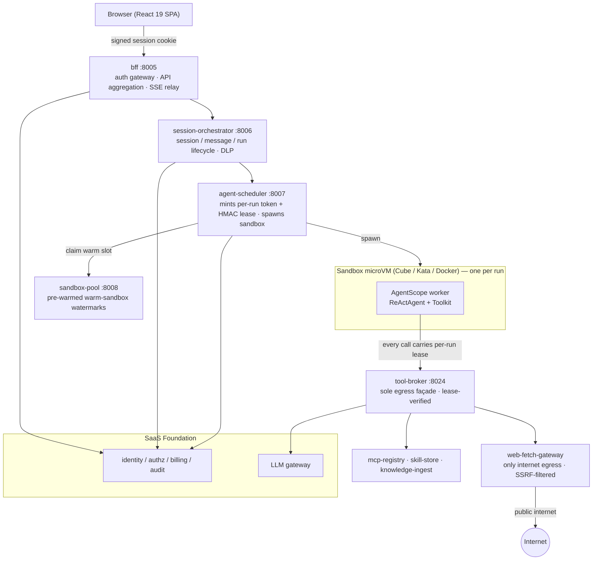

# Agent Platform

English | [中文](README.zh-CN.md)

> Run AI agents that execute untrusted, model-generated code safely — one kernel-isolated microVM sandbox per run, multi-tenant, audited, and billed.

[](./LICENSE)
[](https://www.python.org/)
[](https://react.dev/)
[](https://github.com/agentscope-ai/agentscope)
[](https://github.com/chenzefeng09/saas-foundation)

Agent Platform is an enterprise platform for running AI agents that write and execute their own code. Every agent run is placed in its own kernel-isolated microVM sandbox, so untrusted model-generated code never shares a kernel with the host or with other tenants. The platform is multi-tenant by construction and inherits identity, authorization, billing, audit, and an LLM gateway from [SaaS Foundation](https://github.com/chenzefeng09/saas-foundation), which it is built on top of.

## Why Agent Platform

Letting a model generate and run arbitrary code is the most useful and the most dangerous thing an agent can do. Agent Platform is built around that tension.

- **Kernel-level isolation per run.** Untrusted, model-generated code runs in a CubeSandbox microVM (default) or a Kata Containers microVM (fallback) — not a host-kernel-sharing container. Docker is used only for local dev and CI. One agent per sandbox, one task per agent: the per-run microVM is the unit of tenant isolation, audit, and billing.
- **Default-deny egress.** In broker mode a sandbox joins only an internal network and can reach exactly one thing: the tool-broker façade. Redis, object storage, the identity provider, internal registries, cloud metadata endpoints, and the public internet are all refused at the microVM boundary. The single web-egress service is SSRF-filtered and fail-closed.
- **Per-run capability leases.** The scheduler signs a short-lived HMAC lease for each run. Every call a sandbox makes through the broker (LLM, MCP, skills, web fetch, hot-state, object store) must carry that lease. Real infrastructure credentials live only on the broker — sandboxes hold none.
- **Enterprise governance, inherited not reinvented.** Identity, RBAC/ABAC authorization, quota and metered billing, immutable audit, DLP, and a tenant-scoped LLM gateway all come from SaaS Foundation. Agent Platform wires agent runs into that governance fabric rather than reimplementing it.

## Key features

- One kernel-isolated microVM sandbox per agent run (Cube / Kata / Docker runtimes behind one `SandboxRuntime` interface).
- Pre-warmed sandbox pool for low cold-start latency, with autoscaling driven by a warm-VM metric.
- AgentScope-based agent kernel (`ReActAgent` + `Toolkit`), extended — not forked — through sidecar Python packages.
- Per-tenant MCP server registry, versioned skill packages, and a document → embedding → vector-search knowledge pipeline.
- Templatized agent tasks ("Apps") with a versioned review/publish workflow and cron-scheduled execution.
- All LLM traffic routed through the Foundation LLM gateway with a per-tenant virtual key for quota, routing, and audit.
- Data-loss-prevention on uploads, downloads, run artifacts, and transcripts; tamper-evident audit of every agent event.
- React 19 web app: live SSE chat, human-in-the-loop confirmation cards, in-browser file previews, and a multi-module admin console.
- Bilingual (English / 简体中文) UI and docs.

## Architecture

A browser request flows through the BFF, into session and run orchestration, out to the scheduler, and finally into a per-run sandbox microVM running the AgentScope worker. The sandbox's only path to the outside is the tool-broker façade; the only path to the public internet is the web-fetch gateway.



In **broker egress mode** (the default), the sandbox joins only the internal `sandbox_broker` network and reaches the LLM gateway, MCP registry, skill store, web-fetch gateway, Redis hot-state, and object store **only** through the tool-broker — each call authenticated by the signed per-run lease. The web-fetch gateway is the single service attached to the outbound network.

## Services

The platform is composed of 11 services. Ports below are dev defaults from the Docker Compose stack; several services share container port `8013` internally and are separated by distinct host port mappings, as noted.

| Service | Port (dev) | Purpose |
|---|---|---|
| `bff` | 8005 | Backend-for-frontend: auth gateway, signed cookie session, API aggregation, and SSE relay for the web app. |
| `session-orchestrator` | 8006 | Owns session / message / run lifecycle CRUD, attachment storage, run SSE event streams, and DLP enforcement. |
| `agent-scheduler` | 8007 | Spawns and manages sandbox microVMs/containers running the AgentScope worker; mints the per-run token and HMAC lease. |
| `sandbox-pool` | 8008 | Pre-warms idle sandboxes so runs start warm; exports a Prometheus gauge that drives autoscaling. |
| `mcp-registry` | 8010 | Per-tenant registry of MCP servers (backends) that agents can connect to. |
| `skill-store` | 8011 | Versioned skill-package registry storing tarballs of `skill.yaml` + code per tenant. |
| `knowledge-ingest` | 8012 | Document → embedding → pgvector ingest and semantic-search pipeline; also backs session memory. |
| `app-registry` | container 8013 → host 8014 | Registry of templatized agent tasks ("Apps") with versioned harness and a review/publish workflow. Container port 8013 collides with Foundation's audit service, so it is exposed on host 8014. |
| `cron-runner` | container 8013 → host 8015 | Runs published Apps on a cron schedule (APScheduler), invoking them through the BFF with a service token. Shares container port 8013 with web-fetch-gateway; separated by host port. |
| `web-fetch-gateway` | container 8013 → host 8023 | SSRF-protected outbound HTTP fetch gateway for the agent `WebFetch` tool; the only service on the internet-egress network. |
| `tool-broker` | 8024 | Policy-controlled façade giving broker-mode sandboxes narrow, lease-scoped access to platform tool services. OpenAPI/docs disabled; reachable only by untrusted sandboxes. |

> Note on ports: `app-registry`, `cron-runner`, and `web-fetch-gateway` all listen on container port `8013`. They never collide at runtime because each is published on a distinct host port (8014 / 8015 / 8023). The `8013` choice also avoids the Foundation audit service, which itself uses 8013.

## Tech stack

| Layer | Technologies |
|---|---|
| Frontend | React 19 + TypeScript 5.7, Vite 6, React Router v7, Zustand 5, Tailwind CSS 3; `react-markdown` + `remark-gfm` for chat, `recharts` for admin dashboards, in-browser PDF/DOCX/XLSX previews; custom i18n (en/zh) |
| Frontend tests | Vitest 2 + Testing Library + jsdom; ESLint 9 + typescript-eslint |
| Agent kernel | [AgentScope](https://github.com/agentscope-ai/agentscope) 2.x (Apache-2.0) — `ReActAgent` + `Toolkit` + model/formatter abstraction. Not forked; chosen over OpenHands ([ADR 0002](./docs/adr/0002-agent-kernel-agentscope-over-openhands.md)) |
| Sandbox extensions | `agentscope-ext`: standalone Python 3.12 packages (`runtime_worker`, `llm_gateway_enforcer`, `mcp_tenant_injector`, `skills_loader`, `event_audit_sink`, `web_fetch`) pip-installed into the sandbox image |
| Alternate worker | `worker-claude-sdk`: a TypeScript/Node.js worker on `node:22-slim` honoring the same `task.json` → `result.json` contract |
| Backend services | Python 3.12, FastAPI + uvicorn, Poetry, asyncpg/SQLAlchemy + Alembic, ruff + mypy + pytest; `foundation_sdk` path dependency |
| Sandbox runtimes | CubeSandbox microVM (E2B HTTP protocol, default in prod), Kata Containers + Cloud Hypervisor (fallback), Docker (dev/CI) — selected by `SCHEDULER_RUNTIME` |
| Sandbox images | OCI image tiers (base / office / matlab): Python 3.12 + pinned AgentScope + NumPy/Pandas/Polars/Node 20/Playwright+Chromium; office adds LibreOffice headless; matlab adds MATLAB Runtime. Separate `claude-sdk` image |
| Data infra (from Foundation) | PostgreSQL 16 + pgvector, Redis, MinIO/S3, Keycloak (OIDC), ClickHouse (audit), Vault (KEK) |
| Deploy & ops | Docker Compose (dev + Cube override), Helm chart (small/medium/large profiles with a Foundation subchart), KEDA autoscaling, OpenTelemetry + Prometheus, Locust load tests |

## Quick start

> **Prerequisite — sibling SaaS Foundation checkout.** Agent Platform cannot build, start, or run without [SaaS Foundation](https://github.com/chenzefeng09/saas-foundation) checked out at `../saas-foundation`. It imports `foundation_sdk` (installed editable from the foundation repo), shares a Docker network created by the foundation stack, and calls Foundation's Identity, LLM-gateway, and Billing services at runtime. Clone both repos side by side first.

```text
parent/
├── agent-platform/      # this repo
└── saas-foundation/     # required sibling checkout
```

You will also need: GNU `make` + bash, Docker + Docker Compose v2, Python 3.12 + Poetry, and Node.js 20+ / npm.

```bash
# 1. Bootstrap: poetry install for every service + install the editable foundation SDK into each venv
make bootstrap

# 2. Create your .env from the example (review and adjust before use)
make env

# 3. Start the Foundation dev stack + all agent services
make up

# 4. Run database migrations (session-orchestrator Alembic)
make migrate

# 5. Install and start the frontend
make web-install
make web-dev
```

Then open <http://localhost:5173>. The web app, BFF, orchestrator, and scheduler come up on ports 5173 and 8005–8007.

Useful follow-ups:

```bash
make agent-up           # start only agent services (Foundation already running)
make logs SVC=bff       # follow one service's logs
make ps                 # service status
make down               # stop services
make conformance        # run conformance tests against the running stack
```

To run agents inside CubeSandbox microVMs (a Linux host with `/dev/kvm` is required), see [`docs/runbook/enable-cubesandbox.md`](./docs/runbook/enable-cubesandbox.md).

## Repository layout

| Path | Contents |
|---|---|
| `services/` | The 11 Python (FastAPI) backend services — `bff`, `session-orchestrator`, `agent-scheduler`, `sandbox-pool`, `app-registry`, `skill-store`, `mcp-registry`, `tool-broker`, `knowledge-ingest`, `cron-runner`, `web-fetch-gateway` |
| `apps/web/` | React 19 + Vite single-page app (workspace + admin console) |
| `agentscope-ext/` | Sandbox-side AgentScope extension packages and the `runtime_worker` entrypoint |
| `sandbox-images/` | OCI Dockerfiles for the base / office / matlab sandbox image tiers and the `claude-sdk` worker image |
| `deploy/` | Docker Compose stacks, Helm chart, KEDA operator manifests, Cube egress policy, backup/restore, and load tests |
| `contracts/` | Shared API / wire contracts between services and the sandbox worker |
| `docs/` | ADRs, design docs, runbooks, and roadmap |

## Relationship to SaaS Foundation

Agent Platform is the agent-execution product; [**SaaS Foundation**](https://github.com/chenzefeng09/saas-foundation) is the reusable enterprise base it stands on. SaaS Foundation is a standalone, general-purpose foundation — identity, authorization, organization, billing, audit, compliance, DLP, and an LLM gateway — usable by any business system, not just this one.

Agent Platform depends on it across four axes:

- **SDK / source.** Nearly every service does `import foundation_sdk` (request context, problem-details, the cookie signer). The SDK is installed editable from `../saas-foundation/sdks/python` via `make bootstrap`.
- **Build.** Each service Dockerfile receives the SDK source as a build context, so images are built against the sibling checkout.
- **Network.** Agent services attach to an external Docker network created by the Foundation compose project.
- **Runtime.** The BFF proxies authentication to Foundation Identity; the scheduler mints short-lived per-run JWTs from Foundation Identity; and sandboxes reach Foundation's LLM gateway, audit, and billing using those tokens.

If you want the enterprise base without the agent runtime, start with SaaS Foundation directly.

## Documentation

- [Architecture](./docs/ARCHITECTURE.md) — end-to-end design, the sandbox runtime contract, and the security model.
- [Getting started](./docs/getting-started.md) — a fuller setup and first-run walkthrough.
- [ADR 0001 — sandbox runtime: Cube default, Kata fallback](./docs/adr/0001-sandbox-runtime-cube-default-kata-fallback.md)
- [ADR 0002 — agent kernel: AgentScope over OpenHands](./docs/adr/0002-agent-kernel-agentscope-over-openhands.md)

## Contributing

Contributions are welcome. Please read [CONTRIBUTING.md](./CONTRIBUTING.md) for development setup, coding standards (ruff + mypy + pytest, ESLint for the frontend), and the pull-request process.

## Security

Please report security vulnerabilities responsibly. See [SECURITY.md](./SECURITY.md) for the disclosure process, or email **chenzefeng09@gmail.com**. Please do not open public issues for security reports.

## License

Agent Platform is licensed under the [Apache License 2.0](./LICENSE). See the [`NOTICE`](./NOTICE) file for attribution. Copyright © 2026 The Agent Platform Authors.
