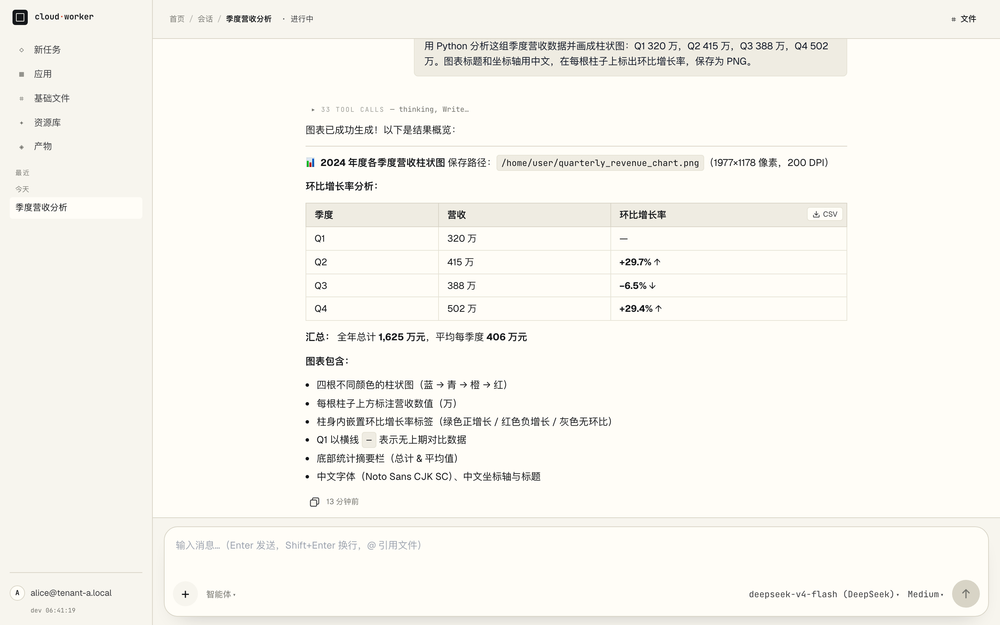
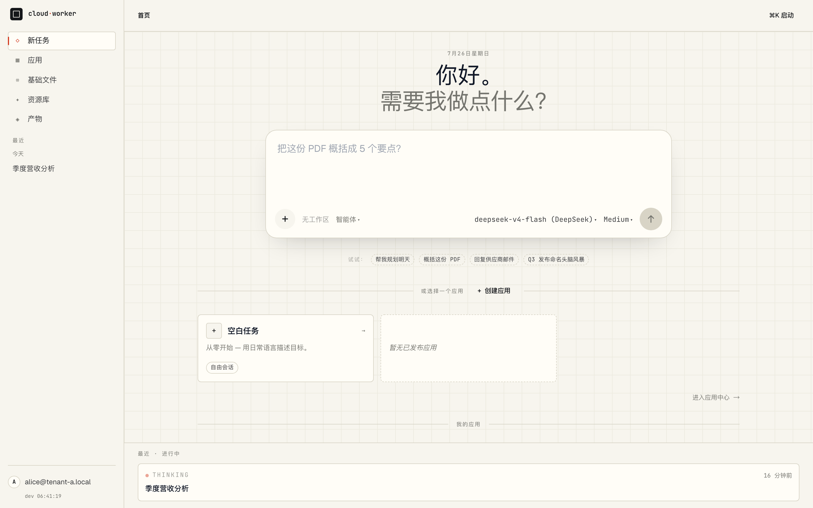
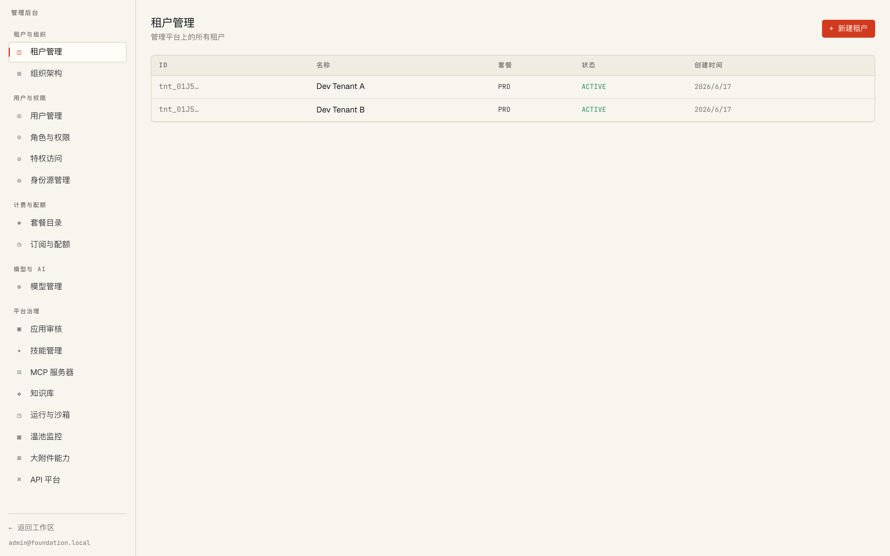

# cloud·worker

[](LICENSE)
[](https://www.python.org/)
[](https://nodejs.org/)
[](https://react.dev/)

**English** · [简体中文](README.zh-CN.md)

An enterprise-grade platform for running AI agents: multi-tenant chat sessions, agent
runs executed inside isolated sandboxes (Docker or microVM), reusable **Apps**, skill
packages, tenant-scoped MCP servers, a knowledge pipeline, and a 28-page admin console.

> **cloud·worker** is the product; the repository is
> [`cloud-worker`](https://github.com/chenzefeng09/cloud-worker). A number of internal
> identifiers still carry the earlier `agent-platform` name — the compose file, the Helm
> chart, image prefixes — and are referred to by their real names below.

cloud·worker is the **business layer**. It runs on top of
[**saas-foundation**](https://github.com/chenzefeng09/saas-foundation) — a separate,
reusable enterprise SaaS base that owns identity, authorization, org, billing, audit,
compliance, LLM gateway, storage, crypto, DLP and feature flags. See
[Relationship with saas-foundation](#relationship-with-saas-foundation).

---

## Screenshots

An agent run: the model writes and executes Python in a sandbox, then reports back with a
rendered table. The `33 TOOL CALLS` row collapses the whole tool transcript; the chart it
produced is a 200 DPI PNG with Chinese labels.



The home surface — task entry, model and reasoning-effort pickers, App cards, and
in-flight runs across the bottom.



The admin console — tenants, users, RBAC, privileged access, plans and quota, model
management, and platform governance (App review, skills, MCP, knowledge, sandboxes).



> **Project status.** Actively developed and deployed for internal pilots — not yet a
> 1.0. Interfaces between services still move. The dev stack is docker-compose; Helm
> charts under `deploy/helm/` exist but get less mileage.

---

## Table of contents

- [What you get](#what-you-get)
- [Relationship with saas-foundation](#relationship-with-saas-foundation)
- [Architecture](#architecture)
- [Repository layout](#repository-layout)
- [Quick start](#quick-start)
- [Configuration](#configuration)
- [Development](#development)
- [Sandbox images](#sandbox-images)
- [Security model](#security-model)
- [Documentation](#documentation)
- [Contributing](#contributing)
- [License](#license)

---

## What you get

**Conversation & execution**

- **Streaming chat sessions** — real token-level streaming over SSE, with thinking
  blocks, grouped/collapsible tool-call steps, and multi-turn history.
- **Sandboxed agent runs** — every run gets a fresh, isolated workspace. Two runtimes:
  Docker (dev) and CubeSandbox microVMs with kernel-level isolation (production, see
  [ADR 0001](docs/adr/0001-sandbox-runtime-cube-default-kata-fallback.md)).
- **One agent runtime** — every run is executed by a TypeScript worker built on the
  [Claude Agent SDK](https://docs.claude.com/en/api/agent-sdk/overview), inside a
  sandbox. Model traffic goes through the foundation LLM gateway with a per-tenant
  virtual key; the worker's adapter translates Anthropic Messages to the gateway's
  OpenAI-compatible API, so the model vendor stays a gateway choice (see
  [ADR 0003](docs/adr/0003-claude-agent-sdk-sole-agent-runtime.md)).
- **Human-in-the-loop** — agents can pause mid-run to ask a question or request
  confirmation; cards survive a page reload and resume the run in place.

**Reusable agent assets**

- **Apps** — package a fixed agent harness (prompt, tools, inputs, model) as a
  versioned, reviewable, publishable App. Run it ad hoc, on a cron schedule, or from an
  inbound webhook (file payloads included). Full per-App run history.
- **Skills** — instruction packages (`SKILL.md` + optional scripts) with progressive
  disclosure. Mounted read-only into the sandbox from a content-addressed host cache,
  so a run costs zero downloads. Ships with a set of platform-global default skills.
- **MCP** — per-tenant registry of MCP servers with custom headers, auth (including
  OAuth), timeouts and tool allow/deny filters. A broker fronts them so sandboxes never
  hold tenant credentials.
- **Knowledge** — document → chunk → embedding → pgvector ingest pipeline. The
  orchestrator prefetches the tenant's top-k hits for each run and appends them to the
  agent's system prompt (an on-demand search tool is not available yet).

**Documents & workspace**

- **Workspaces and files** — session-bound workspaces, `@`-mention file completion, and
  inline preview for PDF / Word / Excel / PowerPoint / archives.
- **Canvas** — a document surface for drafts and executable HTML previewed in a
  sandboxed iframe. Users create and edit canvases; the agent cannot yet create them
  mid-run (see the known gaps in ADR 0003).
- **Artifacts** — run outputs surfaced as downloadable cards in the transcript.

**Operations**

- **Admin console** — 28 modules covering tenants, users, RBAC, SSO, quota, model
  management, audit, session replay, DLP, compliance, data protection, PAM,
  security-ops, lifecycle, feature flags, storage, sandbox pool monitoring and App
  review. Most are thin proxies over saas-foundation services.
- **Multi-tenancy throughout** — Postgres RLS, tenant-scoped storage, per-tenant quota
  enforcement, and per-run LLM virtual keys for cost attribution.

---

## Relationship with saas-foundation

The two repositories split along a single line: **saas-foundation is generic enterprise
plumbing, cloud·worker is everything agent-shaped.**

| | [saas-foundation](https://github.com/chenzefeng09/saas-foundation) | cloud·worker (`cloud-worker`, this repo) |
|---|---|---|
| **Role** | Reusable SaaS base, independently deliverable | Business layer built on that base |
| **Owns** | identity, authz, org, billing, audit, compliance, notification, search, api-platform, llm-gateway, storage, crypto, dlp, data-protection, feature-flag, lifecycle, pam, security-ops | sessions, messages, runs, sandboxes, agent workers, skills, MCP, knowledge, Apps, canvas, artifacts |
| **Knows about** | nothing above it | consumes foundation over HTTP + SDK |

Design rule inherited from the base: **business services never touch the underlying
open-source components directly.** No service in this repo talks to Keycloak, OPA,
LiteLLM, MinIO, Vault or Unleash — it calls the corresponding foundation service, which
means those components can be swapped without touching agent code.

### How the wiring works

1. **`foundation_sdk` (Python)** — each service imports it for cookie signing
   (`CookieSigner`), request-context propagation (`install_request_context`),
   RFC 9457 problem+json error handling (`register_problem_details`) and tenant/user
   extraction (`get_tenant_id`, `get_user_id`).
2. **Shared Docker network** — the agent compose stack joins the foundation stack's
   external network, set by `FOUNDATION_NETWORK` (default `saas-foundation-dev_foundation`).
3. **Service-to-service HTTP** — the BFF proxies admin traffic to foundation services;
   orchestrator and workers reach the LLM gateway with per-run virtual keys.

The SDK reaches your services by one of two paths, documented in
[docs/foundation-sdk-consumption.md](docs/foundation-sdk-consumption.md):

- **Internal PyPI** (CI/production) — `foundation-sdk = ">=0.1,<0.2"` from a private index.
- **Build context** (local dev, the default here) — docker-compose injects the sibling
  checkout's `sdks/python` via `additional_contexts`, so SDK edits show up immediately
  without a release.

### ⚠️ You need saas-foundation to run this

`foundation-sdk` is not on public PyPI. Clone both repositories as siblings:

```
Development/
├── saas-foundation/     # must be running first
└── cloud-worker/        # this repo
```

If your layout differs, override `FOUNDATION_DIR` (Makefile) and `FOUNDATION_SDK_PATH`
(`deploy/docker-compose/.env`).

---

## Architecture

```
                    Browser — React 19 + Vite  (:5173)
                              │  signed cookie session · SSE
                              ▼
              ┌───────────────────────────────────┐        ┌──────────────────────────┐
              │  bff  :8005                       │───────▶│     saas-foundation      │
              │  auth proxy · API aggregation     │        │  identity · authz · org  │
              │  SSE relay · admin proxy          │◀───────│  audit · billing · dlp   │
              └───┬───────────────────────────────┘        │  llm-gateway · storage   │
                  │                                        │  crypto · feature-flag … │
                  │                                        └──────────────────────────┘
   ┌──────────────┼────────────────┬──────────────┬───────────────┬──────────────┐
   ▼              ▼                ▼              ▼               ▼              ▼
session-      app-registry    skill-store    mcp-registry    knowledge-     cron-runner
orchestrator     :8014           :8011          :8010          ingest          :8015
   :8006      versioned        skill pkgs     tenant MCP       :8012         schedules +
sessions ·    harness +       (tarballs)      servers        docs →           webhooks
messages ·    review/publish                                 pgvector
runs · canvas
workspaces
   │
   ▼
agent-scheduler :8007 ───────────────▶ sandbox-pool :8008
spawns one sandbox per run             pre-warmed CubeSandbox microVMs
   │
   ├── runtime: docker  (dev)
   └── runtime: cube    (microVM, kernel isolation)
              │
              ▼
        ┌───────────────────────────────────────────────┐
        │  agent worker inside the sandbox              │
        │  worker-claude-sdk  (TS, Claude Agent SDK)    │
        │  adapter → foundation llm-gateway (vkey)      │
        └───────┬───────────────────────────┬───────────┘
                │                           │
                ▼                           ▼
      tool-broker :8024           web-fetch-gateway :8023
      policy façade for           SSRF-guarded outbound
      foundation tool access      HTTP (allowlist, deny by default)
```

**Request path for one agent turn:** browser → BFF (authenticates, resolves tenant) →
session-orchestrator (persists the message, opens a run) → agent-scheduler (acquires a
sandbox, mints a short-lived token and a per-run LLM virtual key) → worker (drives the
agent loop, calls tools through the broker) → events stream back over Redis → SSE →
browser.

### Services

| Service | Host port | Responsibility |
|---|---|---|
| `web` | 5173 | React 19 SPA — chat, apps, library, workspace, admin console |
| `bff` | 8005 | Auth proxy, API aggregation, SSE relay, admin fan-out |
| `session-orchestrator` | 8006 | Sessions, messages, runs, canvas, workspaces, knowledge prefetch |
| `agent-scheduler` | 8007 | Spawns sandbox containers/microVMs, injects credentials |
| `sandbox-pool` | 8008 | Pre-warmed CubeSandbox microVM pool |
| `mcp-registry` | 8010 | Tenant MCP server registry (encrypted secrets, tool filters) |
| `skill-store` | 8011 | Versioned skill packages |
| `knowledge-ingest` | 8012 | Document → embedding → pgvector pipeline |
| `app-registry` | 8014 | Apps: versioned harness, review, publish |
| `cron-runner` | 8015 | Scheduled + webhook-triggered App execution |
| `web-fetch-gateway` | 8023 | SSRF-protected outbound HTTP for agent tools |
| `tool-broker` | 8024 | Policy-controlled façade for sandbox → foundation calls |

---

## Repository layout

```
cloud-worker/
├── apps/web/              React 19 SPA (Vite, Zustand, Tailwind)
│   └── src/admin/         28-page admin console
├── services/              FastAPI services (Python 3.12, Poetry) — see table above
├── worker-claude-sdk/     TypeScript agent worker — Claude Agent SDK (the only runtime)
├── sandbox-images/        Sandbox Dockerfiles — claude-sdk / claude-sdk-cube / MATLAB
├── libs/                  Shared client libraries (feature flags, quota guard)
├── contracts/             OpenAPI 3.1 specs + worker wire contract
├── deploy/
│   ├── docker-compose/    Dev stack
│   ├── helm/              Kubernetes chart
│   ├── cube/              CubeSandbox controller config
│   └── scripts/           Cert generation, ops helpers
├── docs/
│   ├── adr/               Architecture decision records
│   ├── design/            Rolling design docs
│   └── runbook/           Backup/restore, load test, Cube enablement
└── tests/conformance/     Cross-service conformance suite
```

---

## Quick start

**Prerequisites:** Docker (with Compose v2), Python 3.12 + Poetry, Node 18+, and a
checkout of [saas-foundation](https://github.com/chenzefeng09/saas-foundation) as a
sibling directory.

```bash
git clone https://github.com/chenzefeng09/saas-foundation.git
git clone https://github.com/chenzefeng09/cloud-worker.git
cd cloud-worker
```

```bash
make env
```

That creates `deploy/docker-compose/.env` from the example. Edit it — at minimum set
`BFF_COOKIE_SECRET`, which must be ≥32 chars (startup fails on a weak value):

```bash
python3 -c "import secrets; print(secrets.token_urlsafe(48))"
```

Then bring up both stacks and build the sandbox image:

```bash
make up
```

```bash
make build-claude-sdk-image
```

Open <http://localhost:5173>. Seeded dev users come from the foundation stack — see its
`deploy/docker-compose/README.md`.

Useful targets:

```bash
make ps
```

```bash
make logs SVC=bff
```

```bash
make down
```

To run the frontend outside Docker against the containerized backend:

```bash
make web-install && make web-dev
```

---

## Configuration

Everything lives in `deploy/docker-compose/.env` (start from `.env.example`). The knobs
that matter most:

| Variable | Default | Purpose |
|---|---|---|
| `FOUNDATION_NETWORK` | `saas-foundation-dev_foundation` | External Docker network shared with the foundation stack |
| `FOUNDATION_SDK_PATH` | `../../../saas-foundation/sdks/python` | Sibling SDK source, injected as a build context |
| `BFF_COOKIE_SECRET` | *(empty — you must set it)* | Session cookie signing key, ≥32 chars |
| `SCHEDULER_RUNTIME` | `docker` | `docker` for dev, `cube` for microVM isolation |
| `AGENT_IMAGE` | `ghcr.io/agent-platform/claude-sdk-sandbox:0.1` | Sandbox image (Claude Agent SDK worker) |
| `LLM_MODEL` | see `.env.example` | Default model routed through the foundation LLM gateway |
| `POOL_IDLE_LOW` / `POOL_IDLE_HIGH` / `POOL_MAX_TOTAL` | `2` / `10` / `50` | microVM pool sizing |
| `CUBE_CONTROLLER_URL`, `CUBE_TLS_MODE`, `CUBE_API_KEY` | — | CubeSandbox controller (required when `SCHEDULER_RUNTIME=cube`) |

Enabling the microVM runtime is a separate procedure — see
[docs/runbook/enable-cubesandbox.md](docs/runbook/enable-cubesandbox.md).

---

## Development

```bash
make bootstrap     # poetry install for every service + editable foundation SDK
```

```bash
make lint          # ruff check + mypy across all services
```

```bash
make test          # pytest with coverage across all services
```

```bash
make migrate       # alembic upgrade head (session-orchestrator)
```

```bash
make conformance   # conformance suite against a running stack
```

Frontend, in `apps/web/` — `npm run typecheck`, `npm run lint`, `npm run test`
(vitest), `npm run build`.

Worker, in `worker-claude-sdk/` — `npm run typecheck`, `npm run test`, and `npm run
build` which emits `dist/` for the sandbox image build.

GitHub Actions run per-service pipelines under `.github/workflows/`.

**Note:** most backend services are not hot-reloaded in the compose stack. After
changing service code, rebuild with `make agent-up` (which passes `--build`).

---

## Sandbox images

`sandbox-images/` builds the images an agent run executes inside. All of them run the
Claude Agent SDK worker (`node /app/dist/main.js`, non-root uid 1000):

```
claude-sdk                Docker runtime (dev) · Node 22 + Python office/data libs
claude-sdk-cube           CubeSandbox-native · scientific Python · CMake/native build tools
  └─ claude-sdk-cube-matlab   + MATLAB 2019b (bring-your-own license)
       └─ control / aerospace toolbox layers (build scripts)
claude-sdk-cube-worker-refresh   swap only the worker into an existing Cube image
```

**The default image already does office work — no extra tier, no license needed.**
`claude-sdk.Dockerfile` and `claude-sdk-cube.Dockerfile` ship `python-docx`,
`openpyxl`, `python-pptx`, `pypdf`, `Pillow`, `lxml` and `xlsxwriter` for reading and
writing Word/Excel/PowerPoint/PDF, plus `pandas`, `numpy`, `matplotlib`, `graphviz` and
`diagrams` for analysis and charting. `fonts-noto-cjk` is installed and wired into
`matplotlibrc`, so Chinese/Japanese/Korean labels render correctly instead of as tofu
boxes. All of it is open-source and installed from PyPI/apt. The build asserts the
imports and the CJK font resolve, so a broken image fails at build time rather than
mid-run.

```bash
make build-claude-sdk-image
```

```bash
make build-claude-sdk-cube-image
```

> **MATLAB tiers are bring-your-own.** No MATLAB installer media, license file or
> binaries are included in this repository, and none may be redistributed. The
> `claude-sdk-cube-matlab*` targets expect you to point `MATLAB_ISO_DIR` at your own
> legitimately licensed installation media. Nothing else in the platform depends on
> them — skip these targets entirely and everything above still works.

See [sandbox-images/README.md](sandbox-images/README.md) for the full image matrix.

---

## Security model

Model-generated code is treated as untrusted throughout:

- **Kernel isolation** — production runs land in CubeSandbox microVMs, not shared-kernel
  containers ([ADR 0001](docs/adr/0001-sandbox-runtime-cube-default-kata-fallback.md)).
- **Deny-by-default egress** — sandboxes have no direct internet route. Outbound HTTP
  goes through `web-fetch-gateway`, which enforces an allowlist and blocks SSRF,
  including fake-IP / DNS-rebinding style attacks.
- **Brokered tool access** — sandboxes reach foundation services only through
  `tool-broker`, which applies policy and never hands over tenant credentials.
  Third-party MCP calls have the inbound `Authorization` header stripped.
- **Short-lived, per-run credentials** — the scheduler mints a run-scoped token and an
  LLM virtual key per run. Secrets are passed as files and unlinked rather than left in
  the process environment, so an agent reading `/proc/*/environ` finds nothing.
- **DLP enforcement** — content is checked against foundation DLP rules on uploads,
  downloads and tool calls.
- **Data classification** — files, workspaces and users carry sensitivity levels; access
  requires `file ≤ workspace ≤ user clearance`.
- **Audit and replay** — run events flow to the foundation audit service; session replay
  is gated behind explicit permissions.

Found a security problem? Please report it privately via a
[GitHub security advisory](https://github.com/chenzefeng09/cloud-worker/security/advisories/new)
rather than opening a public issue.

---

## Documentation

| Topic | Document |
|---|---|
| Sandbox runtime decision | [ADR 0001 — CubeSandbox default, Kata fallback](docs/adr/0001-sandbox-runtime-cube-default-kata-fallback.md) |
| Agent runtime decision | [ADR 0003 — Claude Agent SDK as the sole agent runtime](docs/adr/0003-claude-agent-sdk-sole-agent-runtime.md) |
| Agent kernel decision (superseded) | [ADR 0002 — AgentScope over OpenHands](docs/adr/0002-agent-kernel-agentscope-over-openhands.md) |
| Sandbox runtime design | [docs/design/b-m2-sandbox-runtime-v1.md](docs/design/b-m2-sandbox-runtime-v1.md) |
| Consuming the foundation SDK | [docs/foundation-sdk-consumption.md](docs/foundation-sdk-consumption.md) |
| Admin console spec | [docs/admin-console-v2-spec.md](docs/admin-console-v2-spec.md) |
| Canvas design | [docs/canvas-v2-design.md](docs/canvas-v2-design.md) |
| Knowledge library | [docs/knowledge-library-v1.md](docs/knowledge-library-v1.md) |
| DLP defense plan | [docs/dlp-real-defense-plan.md](docs/dlp-real-defense-plan.md) |
| Enabling CubeSandbox | [docs/runbook/enable-cubesandbox.md](docs/runbook/enable-cubesandbox.md) |
| Backup & restore | [docs/runbook/backup-restore-b-m6.md](docs/runbook/backup-restore-b-m6.md) |
| Load testing | [docs/runbook/loadtest-b-m6.md](docs/runbook/loadtest-b-m6.md) |
| Worker wire contract | [contracts/worker-wire-contract.md](contracts/worker-wire-contract.md) |

Some design documents are written in Chinese.

---

## Contributing

Issues and pull requests are welcome.

- Keep `make lint` and `make test` green; frontend changes must pass `npm run typecheck`
  and `npm run build`.
- Changes that cross the cloud·worker / saas-foundation boundary need a matching PR in
  the other repository — say so in the description.
- Architectural changes should come with an ADR under `docs/adr/`.
- Contributions are accepted under Apache 2.0 (see below).

---

## License

Licensed under the **Apache License, Version 2.0** — see [LICENSE](LICENSE).

```
Copyright 2026 The cloud·worker Authors

Licensed under the Apache License, Version 2.0 (the "License");
you may not use this file except in compliance with the License.
You may obtain a copy of the License at

    http://www.apache.org/licenses/LICENSE-2.0

Unless required by applicable law or agreed to in writing, software
distributed under the License is distributed on an "AS IS" BASIS,
WITHOUT WARRANTIES OR CONDITIONS OF ANY KIND, either express or implied.
See the License for the specific language governing permissions and
limitations under the License.
```

Third-party components keep their own licenses. Notably, the agent worker depends on the
[Claude Agent SDK](https://www.npmjs.com/package/@anthropic-ai/claude-agent-sdk), whose
terms are set by Anthropic. MATLAB, if you build those image tiers, requires your own
license from MathWorks.
