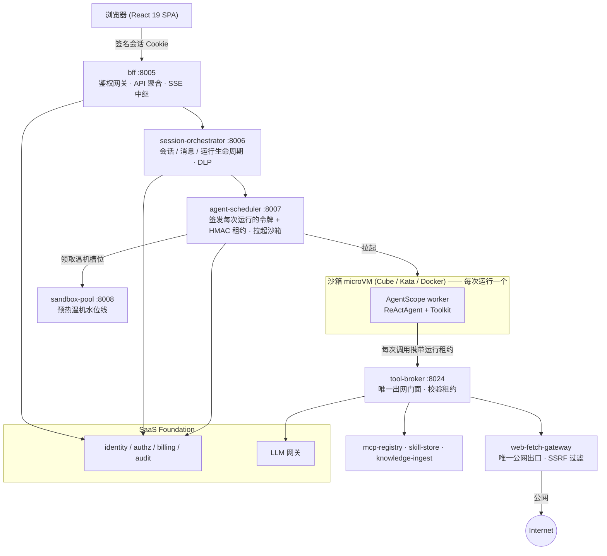

# Agent Platform

[English](README.md) | 中文

> 安全地运行会自行编写并执行代码的 AI 智能体 —— 每次运行独享一个内核级隔离的 microVM 沙箱，多租户、可审计、可计费。

[](./LICENSE)
[](https://www.python.org/)
[](https://react.dev/)
[](https://github.com/agentscope-ai/agentscope)
[](https://github.com/chenzefeng09/saas-foundation)

Agent Platform 是一个面向企业的平台，用于运行会自行编写并执行代码的 AI 智能体。每一次智能体运行都被放入独立的、内核级隔离的 microVM 沙箱中，因此模型生成的不可信代码绝不会与宿主机或其他租户共享内核。平台天生多租户，并从 [SaaS Foundation](https://github.com/chenzefeng09/saas-foundation) 继承身份认证、授权、计费、审计与 LLM 网关能力 —— Agent Platform 正是构建在它之上。

## 为什么选择 Agent Platform

让模型自由生成并执行任意代码，是智能体最有用、也最危险的能力。Agent Platform 正是围绕这一张力设计的。

- **每次运行内核级隔离。** 模型生成的不可信代码运行在 CubeSandbox microVM（默认）或 Kata Containers microVM（兜底）中，而非与宿主机共享内核的容器；Docker 仅用于本地开发与 CI。一个沙箱一个智能体、一个智能体一个任务：每次运行的 microVM 即是租户隔离、审计与计费的边界单元。
- **默认拒绝出网。** 在 broker 模式下，沙箱只接入内部网络，且只能访问唯一一个目标 —— tool-broker 门面。Redis、对象存储、身份提供方、内部注册表、云元数据端点以及公网，都在 microVM 边界处被拒绝。唯一的 Web 出网服务经过 SSRF 过滤，并采用失败即关闭（fail-closed）策略。
- **每次运行的能力租约。** 调度器为每次运行签发一个短时效的 HMAC 租约。沙箱经由 broker 发起的每一次调用（LLM、MCP、技能、Web 抓取、热状态、对象存储）都必须携带该租约。真实的基础设施凭据只存在于 broker 上 —— 沙箱不持有任何凭据。
- **企业治理：继承而非重造。** 身份认证、RBAC/ABAC 授权、配额与计量计费、不可篡改审计、DLP 以及租户级 LLM 网关，全部来自 SaaS Foundation。Agent Platform 将智能体运行接入这套治理体系，而不是重新实现它。

## 核心特性

- 每次智能体运行独享一个内核级隔离的 microVM 沙箱（Cube / Kata / Docker 三种运行时统一在同一 `SandboxRuntime` 接口之后）。
- 预热沙箱池以降低冷启动延迟，并由温机指标驱动自动伸缩。
- 基于 AgentScope 的智能体内核（`ReActAgent` + `Toolkit`），通过 sidecar Python 包扩展 —— 而非 fork。
- 租户级 MCP 服务器注册表、版本化技能包，以及「文档 → 向量嵌入 → 向量检索」的知识管线。
- 模板化的智能体任务（「Apps」）：带版本化的审核/发布流程，并支持按 cron 定时执行。
- 所有 LLM 流量经由 Foundation LLM 网关，使用租户级虚拟密钥进行配额、路由与审计。
- 对上传、下载、运行产物与会话记录进行数据防泄漏（DLP）；对每个智能体事件进行防篡改审计。
- React 19 Web 应用：实时 SSE 对话、人在回路（HITL）确认卡片、浏览器内文件预览，以及多模块管理控制台。
- 双语（English / 简体中文）界面与文档。

## 架构

一次浏览器请求经由 BFF，进入会话与运行编排，再到调度器，最终进入一个运行 AgentScope worker 的、每次运行独享的沙箱 microVM。沙箱通向外部的唯一路径是 tool-broker 门面；通向公网的唯一路径是 web-fetch 网关。



在 **broker 出网模式**（默认）下，沙箱只接入内部 `sandbox_broker` 网络，且**只能**经由 tool-broker 访问 LLM 网关、MCP 注册表、技能库、web-fetch 网关、Redis 热状态与对象存储 —— 每次调用都由签名的运行租约鉴权。web-fetch 网关是唯一接入出网网络的服务。

## 服务

平台由 11 个服务组成。下表端口为 Docker Compose 开发栈的默认值；其中若干服务在容器内部共享 `8013` 端口，通过不同的宿主机端口映射加以区分，已在表中注明。

| 服务 | 端口（开发） | 用途 |
|---|---|---|
| `bff` | 8005 | 后端聚合层：鉴权网关、签名 Cookie 会话、API 聚合，以及为 Web 应用做 SSE 中继。 |
| `session-orchestrator` | 8006 | 负责会话 / 消息 / 运行生命周期的 CRUD、附件存储、运行 SSE 事件流，以及 DLP 强制执行。 |
| `agent-scheduler` | 8007 | 拉起并管理运行 AgentScope worker 的沙箱 microVM/容器；签发每次运行的令牌与 HMAC 租约。 |
| `sandbox-pool` | 8008 | 预热空闲沙箱以保证运行温启动；导出 Prometheus 指标用于驱动自动伸缩。 |
| `mcp-registry` | 8010 | 租户级 MCP 服务器（后端）注册表，供智能体连接。 |
| `skill-store` | 8011 | 版本化技能包注册表，按租户存储 `skill.yaml` + 代码的 tar 包。 |
| `knowledge-ingest` | 8012 | 「文档 → 向量嵌入 → pgvector」入库与语义检索管线；同时支撑会话记忆。 |
| `app-registry` | 容器 8013 → 宿主 8014 | 模板化智能体任务（「Apps」）的注册表，带版本化 harness 与审核/发布流程。容器端口 8013 与 Foundation 审计服务冲突，故以宿主机 8014 暴露。 |
| `cron-runner` | 容器 8013 → 宿主 8015 | 按 cron 定时运行已发布的 Apps（APScheduler），经由 BFF 用服务令牌触发。与 web-fetch-gateway 共用容器端口 8013，由宿主机端口区分。 |
| `web-fetch-gateway` | 容器 8013 → 宿主 8023 | 为智能体 `WebFetch` 工具提供受 SSRF 保护的出站 HTTP 抓取网关；唯一接入公网出口网络的服务。 |
| `tool-broker` | 8024 | 受策略控制的门面，向 broker 模式的沙箱提供对平台工具服务的、按租约限定的窄访问。已禁用 OpenAPI/docs；只有不可信沙箱可达。 |

> 端口说明：`app-registry`、`cron-runner` 与 `web-fetch-gateway` 在容器内均监听 `8013`，但它们各自映射到不同的宿主机端口（8014 / 8015 / 8023），运行时不会冲突。选用 `8013` 同时也是为了避开 Foundation 审计服务（其自身使用 8013）。

## 技术栈

| 层次 | 技术 |
|---|---|
| 前端 | React 19 + TypeScript 5.7、Vite 6、React Router v7、Zustand 5、Tailwind CSS 3；`react-markdown` + `remark-gfm` 渲染对话，`recharts` 用于管理面板，浏览器内 PDF/DOCX/XLSX 预览；自研 i18n（en/zh） |
| 前端测试 | Vitest 2 + Testing Library + jsdom；ESLint 9 + typescript-eslint |
| 智能体内核 | [AgentScope](https://github.com/agentscope-ai/agentscope) 2.x（Apache-2.0）—— `ReActAgent` + `Toolkit` + 模型/格式化器抽象。未 fork；相较 OpenHands 的选型理由见 [ADR 0002](./docs/adr/0002-agent-kernel-agentscope-over-openhands.md) |
| 沙箱扩展 | `agentscope-ext`：独立的 Python 3.12 包（`runtime_worker`、`llm_gateway_enforcer`、`mcp_tenant_injector`、`skills_loader`、`event_audit_sink`、`web_fetch`），pip 安装进沙箱镜像 |
| 备选 worker | `worker-claude-sdk`：基于 `node:22-slim` 的 TypeScript/Node.js worker，遵循同一 `task.json` → `result.json` 契约 |
| 后端服务 | Python 3.12、FastAPI + uvicorn、Poetry、asyncpg/SQLAlchemy + Alembic、ruff + mypy + pytest；`foundation_sdk` 路径依赖 |
| 沙箱运行时 | CubeSandbox microVM（E2B HTTP 协议，生产默认）、Kata Containers + Cloud Hypervisor（兜底）、Docker（开发/CI）—— 由 `SCHEDULER_RUNTIME` 选择 |
| 沙箱镜像 | OCI 镜像分层（base / office / matlab）：Python 3.12 + 锁定版 AgentScope + NumPy/Pandas/Polars/Node 20/Playwright+Chromium；office 增加 LibreOffice headless；matlab 增加 MATLAB Runtime。另有独立的 `claude-sdk` 镜像 |
| 数据设施（来自 Foundation） | PostgreSQL 16 + pgvector、Redis、MinIO/S3、Keycloak（OIDC）、ClickHouse（审计）、Vault（KEK） |
| 部署与运维 | Docker Compose（开发 + Cube override）、Helm chart（small/medium/large 三档，含 Foundation 子 chart）、KEDA 自动伸缩、OpenTelemetry + Prometheus、Locust 压测 |

## 快速开始

> **前置条件 —— 并列的 SaaS Foundation 检出。** 没有在 `../saas-foundation` 检出 [SaaS Foundation](https://github.com/chenzefeng09/saas-foundation)，Agent Platform 既无法构建、也无法启动或运行。它会导入 `foundation_sdk`（以可编辑方式从 foundation 仓库安装）、共享由 foundation 栈创建的 Docker 网络，并在运行时调用 Foundation 的 Identity、LLM 网关与 Billing 服务。请先将两个仓库并列克隆。

```text
parent/
├── agent-platform/      # 本仓库
└── saas-foundation/     # 必需的并列检出
```

你还需要：GNU `make` + bash、Docker + Docker Compose v2、Python 3.12 + Poetry，以及 Node.js 20+ / npm。

```bash
# 1. 引导：为每个服务执行 poetry install，并把可编辑的 foundation SDK 装入各自 venv
make bootstrap

# 2. 从示例创建 .env（使用前请检查并调整）
make env

# 3. 启动 Foundation 开发栈 + 所有 agent 服务
make up

# 4. 执行数据库迁移（session-orchestrator 的 Alembic）
make migrate

# 5. 安装并启动前端
make web-install
make web-dev
```

然后打开 <http://localhost:5173>。Web 应用、BFF、orchestrator 与 scheduler 分别监听 5173 与 8005–8007 端口。

常用后续命令：

```bash
make agent-up           # 仅启动 agent 服务（Foundation 已在运行）
make logs SVC=bff       # 跟踪单个服务的日志
make ps                 # 服务状态
make down               # 停止服务
make conformance        # 对运行中的栈执行一致性测试
```

要在 CubeSandbox microVM 中运行智能体（需要带 `/dev/kvm` 的 Linux 宿主机），参见 [`docs/runbook/enable-cubesandbox.md`](./docs/runbook/enable-cubesandbox.md)。

## 仓库结构

| 路径 | 内容 |
|---|---|
| `services/` | 11 个 Python（FastAPI）后端服务 —— `bff`、`session-orchestrator`、`agent-scheduler`、`sandbox-pool`、`app-registry`、`skill-store`、`mcp-registry`、`tool-broker`、`knowledge-ingest`、`cron-runner`、`web-fetch-gateway` |
| `apps/web/` | React 19 + Vite 单页应用（工作区 + 管理控制台） |
| `agentscope-ext/` | 沙箱侧的 AgentScope 扩展包与 `runtime_worker` 入口 |
| `sandbox-images/` | base / office / matlab 沙箱镜像分层与 `claude-sdk` worker 镜像的 OCI Dockerfile |
| `deploy/` | Docker Compose 栈、Helm chart、KEDA operator 清单、Cube 出网策略、备份/恢复与压测 |
| `contracts/` | 服务之间及与沙箱 worker 之间的共享 API / 线缆契约 |
| `docs/` | ADR、设计文档、运维手册与路线图 |

## 与 SaaS Foundation 的关系

Agent Platform 是智能体执行产品；[**SaaS Foundation**](https://github.com/chenzefeng09/saas-foundation) 是它所依托的可复用企业底座。SaaS Foundation 是一个独立、通用的底座 —— 身份认证、授权、组织、计费、审计、合规、DLP 与 LLM 网关 —— 可供任何业务系统使用，而不仅限于本项目。

Agent Platform 在四个层面依赖它：

- **SDK / 源码。** 几乎每个服务都会 `import foundation_sdk`（请求上下文、problem-details、Cookie 签名器）。该 SDK 通过 `make bootstrap` 从 `../saas-foundation/sdks/python` 以可编辑方式安装。
- **构建。** 每个服务的 Dockerfile 都以构建上下文方式接收 SDK 源码，因此镜像基于并列检出构建。
- **网络。** agent 服务接入由 Foundation compose 项目创建的外部 Docker 网络。
- **运行时。** BFF 将鉴权代理到 Foundation Identity；调度器从 Foundation Identity 签发短时效的每次运行 JWT；沙箱则用这些令牌访问 Foundation 的 LLM 网关、审计与计费。

如果你只需要企业底座而不需要智能体运行时，可直接从 SaaS Foundation 入手。

## 文档

- [架构](./docs/ARCHITECTURE.md) —— 端到端设计、沙箱运行时契约与安全模型。
- [快速上手](./docs/getting-started.md) —— 更完整的搭建与首次运行指引。
- [ADR 0001 —— 沙箱运行时：Cube 默认、Kata 兜底](./docs/adr/0001-sandbox-runtime-cube-default-kata-fallback.md)
- [ADR 0002 —— 智能体内核：选用 AgentScope 而非 OpenHands](./docs/adr/0002-agent-kernel-agentscope-over-openhands.md)

## 贡献

欢迎贡献。请阅读 [CONTRIBUTING.md](./CONTRIBUTING.md) 了解开发环境搭建、编码规范（ruff + mypy + pytest，前端使用 ESLint）以及 Pull Request 流程。

## 安全

请负责任地报告安全漏洞。披露流程参见 [SECURITY.md](./SECURITY.md)，或发送邮件至 **chenzefeng09@gmail.com**。请勿为安全问题创建公开 issue。

## 许可证

Agent Platform 采用 [Apache License 2.0](./LICENSE) 许可。署名信息见 [`NOTICE`](./NOTICE) 文件。版权所有 © 2026 The Agent Platform Authors。
