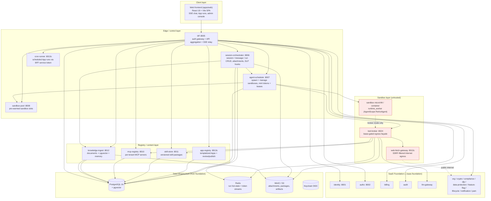
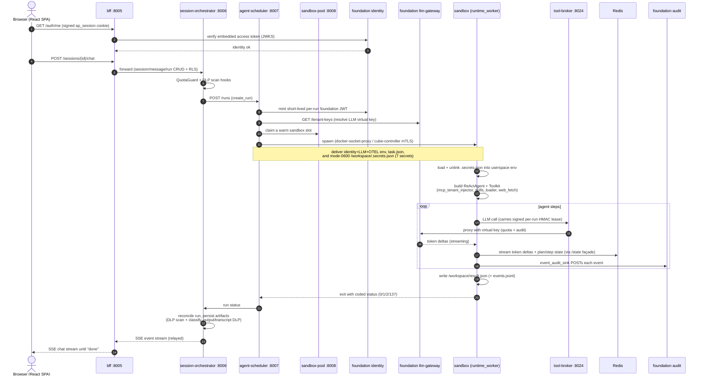

English | [中文](ARCHITECTURE.zh-CN.md)

# Agent Platform architecture

Agent Platform runs untrusted, model-generated agent code inside per-run microVMs
and gives each run a default-deny network with a single brokered egress path. It
is built **on top of** [SaaS Foundation](https://github.com/chenzefeng09/saas-foundation),
which supplies identity, authorization, billing, audit, and the LLM gateway. This
document is the system-level guide: the layering, the end-to-end run lifecycle, a
reference for every service, the agent runtime contract, the sandbox runtimes, the
security model, and the deployment topologies.

> **Relationship to SaaS Foundation.** Agent Platform imports `foundation_sdk` and
> calls Foundation services for identity/authz/billing/audit/LLM-gateway. It
> requires a sibling checkout of `saas-foundation` at `../saas-foundation`. SaaS
> Foundation is a standalone, reusable enterprise base usable by any business
> system; Agent Platform is one such system. See the
> [agent-platform repo](https://github.com/chenzefeng09/agent-platform) and the
> [saas-foundation repo](https://github.com/chenzefeng09/saas-foundation).

## Table of contents

- [Layered overview](#layered-overview)
- [End-to-end run lifecycle](#end-to-end-run-lifecycle)
- [Service reference](#service-reference)
- [The agent runtime](#the-agent-runtime)
- [Sandbox runtimes](#sandbox-runtimes)
- [Security and isolation model](#security-and-isolation-model)
- [Deployment topologies](#deployment-topologies)
- [Further reading](#further-reading)

## Layered overview

The platform is organized into five layers. The browser talks only to the BFF; the
BFF and the platform services call SaaS Foundation for cross-cutting concerns; agent
code runs in isolated sandboxes that can reach the rest of the system **only** through
the tool-broker façade (in broker egress mode).

> **Port notation.** `:8013c` marks services whose **container** port is `8013` but
> whose **dev-compose host** port differs to avoid a collision with the Foundation
> audit service (also container `8013`). The host mappings are: `app-registry` host
> `8014`, `cron-runner` host `8015`, `web-fetch-gateway` host `8023`. See the
> [service reference](#service-reference) for exact values.

**Layer responsibilities**

| Layer | Owns | Trust |
|---|---|---|
| Client | The React SPA, SSE chat rendering, App run/result UI, the `/admin/*` governance console | Browser, authenticated via signed cookie |
| Edge / control | Session terminus, run lifecycle, sandbox scheduling, pool warm-up, cron | Trusted, holds infra credentials |
| Registry / content | Apps, Skills, MCP servers, knowledge/memory | Trusted, tenant-scoped via RLS |
| Sandbox | The agent itself plus its egress façades | **Untrusted** — runs model-generated code |
| Foundation + data | Identity, authz, billing, audit, LLM gateway, and the shared data stores | Trusted, separate repo |

## End-to-end run lifecycle

The sequence below narrates a single chat/run from the browser through to a `done`
SSE event, following the platform data flow. Steps in **broker egress mode** (the
default) route every sandbox call through the tool-broker; the sandbox itself holds
no infrastructure credentials.

Narrated steps:

1. **Session.** The browser holds a BFF-signed `ap_session` cookie. `AuthGate` calls
   the BFF `/auth/me`, which forwards the embedded access token to Foundation identity
   for JWKS verification.
2. **Chat/run request.** The SPA POSTs to the BFF (auth gateway + API aggregation +
   SSE relay), which forwards to the **session-orchestrator** for session/message/run
   CRUD under RLS. The orchestrator owns the DLP `check:download` / scan hooks and
   enforces quota with a billing `QuotaGuard`.
3. **create_run.** The orchestrator mints (via the scheduler path) a short-lived
   per-run Foundation JWT and calls the **agent-scheduler**.
4. **Resolve + spawn.** The scheduler resolves the tenant LLM virtual key
   (`llm-gateway GET /tenant-keys`) and, via the selected `SandboxRuntime`
   implementation (Docker through docker-socket-proxy, or Cube through the
   cube-controller over mTLS on `:8443`), spawns a sandbox from a warm **sandbox-pool**
   slot. It delivers identity + LLM + OTEL env, `task.json` (`{task, mcp_servers,
   skills}`), and a mode-`0600` `/workspace/.secrets.json` carrying the 7 control-plane
   secrets.
5. **Build the agent.** Inside the sandbox, `runtime_worker` loads and immediately
   unlinks the secrets file, then builds a fresh `ReActAgent` + `Toolkit`:
   `mcp_tenant_injector` pulls the tenant MCP servers from `mcp-registry`,
   `skills_loader` mounts packaged Skills, and `web_fetch` adds the `WebFetch` tool.
6. **Run (broker egress).** In broker mode the sandbox can reach **only** the
   tool-broker façade + DNS. LLM calls go `llm_gateway_enforcer -> tool-broker ->
   Foundation llm-gateway` (virtual key + quota + audit); Redis hot-state / token
   streams and S3 artifacts go through the tool-broker `/state` and `/s3` façades; web
   fetches go `web_fetch -> web-fetch-gateway` (SSRF-filtered). Every call carries the
   signed per-run lease.
7. **Persist + exit.** The worker streams token deltas + plan/step state to Redis,
   writes `/workspace/result.json` (+ `events.jsonl`), and exits with a coded status.
   `event_audit_sink` also POSTs each event to Foundation audit.
8. **Reconcile + relay.** The scheduler polls run status; the orchestrator reconciles
   completion (`reconcile_sweeper`), persists artifacts (DLP scan + classification
   tag), applies output/transcript DLP, and relays the SSE stream back through the BFF
   to the browser until `done`. The **cron-runner** can drive App runs on a schedule
   via the BFF service token.

## Service reference

Eleven services make up the Agent Platform. All are Python 3.12 (FastAPI + uvicorn,
Poetry) unless noted, and most install the `foundation_sdk` for request-context and
RFC-7807 problem-details. Ports marked **container `8013`** use a different
dev-compose **host** port (shown in parentheses) to avoid colliding with the
Foundation audit service.

| Service | Port (container / dev host) | One-liner |
|---|---|---|
| [bff](#bff) | 8005 | Auth gateway, cookie session, API aggregation, SSE relay |
| [session-orchestrator](#session-orchestrator) | 8006 | Session / message / run lifecycle, attachments, run SSE |
| [agent-scheduler](#agent-scheduler) | 8007 | Spawns + manages sandboxes per run |
| [sandbox-pool](#sandbox-pool) | 8008 | Pre-warms idle sandbox slots |
| [skill-store](#skill-store) | 8011 | Versioned skill-package registry |
| [mcp-registry](#mcp-registry) | 8010 | Per-tenant MCP server registry |
| [knowledge-ingest](#knowledge-ingest) | 8012 | Document → pgvector ingest + semantic search |
| [app-registry](#app-registry) | 8013 / 8014 | Templatized Apps with review/publish |
| [cron-runner](#cron-runner) | 8013 / 8015 | Scheduled App runs via the BFF |
| [web-fetch-gateway](#web-fetch-gateway) | 8013 / 8023 | SSRF-protected outbound HTTP fetch |
| [tool-broker](#tool-broker) | 8024 | Lease-gated egress façade for sandboxes |

### bff

**Backend-for-frontend — port 8005.** FastAPI title *Agent Platform — BFF*, API prefix
`/api/bff/v1`. It terminates the browser session (signed `ap_session` cookie via
`foundation_sdk.CookieSigner` + `SessionMiddleware`), exposes login/logout/me against
identity-service, and fans out to every platform and Foundation service, aggregating
and relaying responses (including the SSE chat stream). It has a small BFF-local DB
(`agent_bff` schema) for notification preferences and API keys, and accepts a shared
`X-Service-Token` for machine callers such as `cron-runner`.

- **Key endpoints:** `POST /auth/login`, `GET /auth/me`, `POST /auth/logout`;
  `GET/POST /sessions`, `POST /sessions/{session_id}/chat`,
  `GET /sessions/{session_id}/stream` (SSE); `GET/POST /apps`,
  `POST /apps/{app_id}/run`; `GET/POST /library/{mcp-servers,skills,documents}`;
  `GET /fleet/{pool,sandboxes,topology}`; `GET/POST /schedules`;
  `GET/POST/DELETE /api-keys`; `GET .../admin/*` (governance proxies for authz, org,
  identity, sso, billing, model, audit, flags, platform, notification, api-platform,
  pam, dlp, compliance, security-ops, lifecycle, data-protection, large-attachment,
  metrics); `GET /healthz`.
- **Depends on:** `foundation_sdk`; session-orchestrator, agent-scheduler,
  sandbox-pool, app-registry, mcp-registry, skill-store, knowledge-ingest,
  cron-runner; Foundation identity / authz / org / billing / audit / feature-flag /
  llm-gateway / notification / api-platform / pam / dlp / compliance / security-ops /
  lifecycle / data-protection; Postgres (`agent_bff` schema).

### session-orchestrator

**Owns session / message / run lifecycle — port 8006.** FastAPI title *Agent Session
Orchestrator*, API prefix `/api/session/v1`. It persists sessions, messages, and runs
in its own `session_orchestrator` Postgres schema, stores attachments in S3/MinIO, and
reads agent run hot-state (plan/step/cursor) from Redis. It kicks off runs by calling
the agent-scheduler, runs background loops for session-retention sweeps and run
reconciliation, and enforces quota via a billing `QuotaGuard` plus DLP checks on the
attachment path.

- **Key endpoints:** `GET/POST /sessions`, `GET/PATCH/DELETE /sessions/{session_id}`;
  `GET/POST /sessions/{session_id}/messages`; `POST /sessions/{session_id}/runs`,
  `GET /sessions/{session_id}/runs/{run_id}/state`,
  `GET /sessions/{session_id}/runs/{run_id}/events` (SSE),
  `POST /sessions/{session_id}/runs/{run_id}/cancel`;
  `POST/GET /sessions/{session_id}/attachments`,
  `GET /sessions/{session_id}/files/{file_id}/content`;
  `GET /runs/token-usage/daily`; `GET /healthz`.
- **Depends on:** `foundation_sdk`; agent-scheduler; knowledge-ingest (memory
  pre-fetch + write-back); Foundation authz / billing / feature-flag / dlp; Postgres;
  Redis (run hot-state); S3/MinIO (attachments).

### agent-scheduler

**Spawns and manages sandboxes — port 8007.** FastAPI title *Agent Scheduler*, API
prefix `/api/scheduler/v1`. It builds a pluggable sandbox runtime (`docker` or `cube`)
at startup and, on `POST /runs`, mints a per-run scope-limited tenant token from
Foundation identity, signs an HMAC tool-broker capability lease, and starts a sandbox
via the docker-socket-proxy with the configured egress mode (`broker` / `foundation` /
`none`). It injects runtime extensions (`mcp_tenant_injector`, `skills_loader`,
`web_fetch`, `event_audit_sink`, `llm_gateway_enforcer`), forwards registry/gateway
URLs, and enforces billing quota via `QuotaGuard`.

- **Key endpoints:** `POST /runs`, `GET /runs`, `GET /runs/{run_id}`,
  `POST /runs/{run_id}/cancel`, `GET /runs/{run_id}/events` (SSE);
  `GET /sandboxes`, `POST /sandboxes/{sandbox_id}/stop`; `GET /healthz`.
- **Depends on:** `foundation_sdk`; `feature-flag-client`; docker-socket-proxy (no
  direct `docker.sock`); tool-broker (façade URL + shared HMAC lease secret);
  session-orchestrator, mcp-registry, skill-store, web-fetch-gateway; Foundation
  identity / keycloak / authz / billing / feature-flag / llm-gateway; Redis, S3/MinIO
  (forwarded into sandboxes).

### sandbox-pool

**Pre-warms idle sandbox slots — port 8008.** FastAPI title *Sandbox Pool*, API prefix
`/api/sandbox-pool/v1`. An in-memory `Pool` class maintains low/high idle watermarks
and a max-total cap, driven by a periodic warmup/reap ticker in the lifespan; it starts
and stops sandbox containers through the docker-socket-proxy and attaches them to the
internal `sandbox_broker` network. It exposes a Prometheus `/metrics` ASGI mount
(per-app `CollectorRegistry`). Production swaps the in-memory skeleton for a KEDA-driven
operator.

- **Key endpoints:** `POST /sandboxes` (claim/checkout),
  `DELETE /sandboxes/{...}`, `GET /sandboxes/_pool` (pool status); `GET /healthz`;
  `GET /metrics` (Prometheus).
- **Depends on:** `foundation_sdk`; docker-socket-proxy; `prometheus-client`;
  CubeSandbox controller (`SANDBOX_POOL_CUBE_CONTROLLER_URL`, optional in dev).

### skill-store

**Versioned skill-package registry — port 8011.** FastAPI title *Skill Store*, API
prefix `/api/skills/v1`. It manages skill metadata in Postgres and stores versioned
skill tarballs in a pluggable blob backend (S3/MinIO by default, in-memory for tests).
It supports listing/installing/uninstalling skills, uploading new versions, downloading
version tarballs, and internal resolve endpoints (`skill.read_internal` scope) that the
scheduler's `skills_loader` uses to bind-mount content-addressed skills into sandboxes.
Billing is enforced via `QuotaGuard`.

- **Key endpoints:** `GET /skills`, `GET /skills/installed`,
  `GET/DELETE /skills/{skill_id}`, `GET /skills/{skill_id}/versions`,
  `GET /skills/{skill_id}/versions/{version}/download`;
  `GET /internal/skills`, `/internal/skills/resolve`; `GET /healthz`.
- **Depends on:** `foundation_sdk`; `feature-flag-client`; Foundation authz / billing /
  feature-flag; Postgres; S3/MinIO (skill tarballs).

### mcp-registry

**Per-tenant MCP server registry — port 8010.** FastAPI title *MCP Registry*, API
prefix `/api/mcp/v1`. It provides tenant-scoped CRUD over MCP server records persisted
in Postgres (`public` schema), and exposes an internal listing endpoint guarded by the
`mcp.read_internal` service scope that the scheduler's `mcp_tenant_injector` (via the
tool-broker) calls to inject the tenant's MCP servers into each sandbox.

- **Key endpoints:** `GET/POST /mcp-servers`, `GET /mcp-servers/{server_id}`,
  `PATCH /mcp-servers/{server_id}`, `DELETE /mcp-servers/{server_id}`;
  `GET /internal/mcp-servers` (`mcp.read_internal` scope); `GET /healthz`.
- **Depends on:** `foundation_sdk`; Foundation authz; Postgres.

### knowledge-ingest

**Document → embedding → pgvector pipeline — port 8012.** FastAPI title *Knowledge
Ingest*, API prefix `/api/knowledge/v1`. It ingests uploaded documents (stored in a
pluggable blob backend: S3/MinIO or in-memory), generates embeddings via a pluggable
client (local by default, or the Foundation llm-gateway), and writes vectors into
Postgres with the `pgvector` extension. It serves document CRUD and a vector `/search`
endpoint, which session-orchestrator uses for memory pre-fetch/write-back. Billing is
enforced via `QuotaGuard`.

- **Key endpoints:** `GET/POST /documents` (ingest), `GET /documents/{document_id}`,
  `DELETE /documents/{document_id}`, `POST /documents/{document_id}/...` (reingest);
  `GET /search` (vector search); `GET /healthz`.
- **Depends on:** `foundation_sdk`; Foundation authz / billing / llm-gateway
  (embeddings backend); Postgres + pgvector; S3/MinIO (documents).

### app-registry

**Templatized Apps with review/publish — container port 8013 (dev host 8014).** FastAPI
title *App Registry*, API prefix `/api/apps/v1`. It stores Apps and AppVersions in its
own `app_registry` Postgres schema (with RLS, owned by its Alembic env) and manages the
App lifecycle: create/update apps, create versions, submit for review, approve/reject,
and publish. It also exposes `/internal` resolve routes gated by a service scope so the
BFF run resolver and scheduler can look up published App harnesses.

> **Port note.** Container port `8013` collides with the Foundation audit service, so
> dev-compose maps it to host port `8014`.

- **Key endpoints:** `GET/POST /apps`, `GET/PUT/DELETE /apps/{app_id}`,
  `POST /apps/{app_id}/versions`, `PUT /apps/{app_id}/versions/{vid}`,
  `POST .../versions/{vid}/submit`, `/approve`, `/reject`, `/publish` (review
  workflow); `GET .../internal` resolve (service-scope gated); `GET /healthz`.
- **Depends on:** `foundation_sdk`; Foundation authz; Postgres (`app_registry` schema).

### cron-runner

**Scheduled App execution — container port 8013 (dev host 8015).** FastAPI title *Cron
Runner*, API prefix `/api/cron/v1`; uses APScheduler. On startup it spins up an
`AsyncIOScheduler` and loads all persisted enabled cron jobs from its `cron_runner`
Postgres schema, then triggers each scheduled App run by calling the BFF with a shared
service token (`BFF_SERVICE_TOKEN`). It exposes CRUD over cron jobs and standard health
endpoints.

> **Port note.** Container port `8013` collides with `web-fetch-gateway`'s container
> port; the two are separated by distinct dev-compose host mappings (`8015` vs `8023`).
> Unlike most services, cron-runner is a plain FastAPI app and does **not** use
> `foundation_sdk` (no `install_request_context`).

- **Key endpoints:** `GET/POST /cron-jobs`, `PATCH /cron-jobs/{job_id}`,
  `DELETE /cron-jobs/{job_id}`; `GET /healthz`, `/readyz`.
- **Depends on:** bff (App execution via `BFF_SERVICE_TOKEN`); `apscheduler`; Postgres
  (`cron_runner` schema).

### web-fetch-gateway

**SSRF-protected outbound fetch — container port 8013 (dev host 8023).** FastAPI title
*Web Fetch Gateway*, API prefix `/api/web-fetch/v1`. Agents (via the tool-broker) POST
a URL to `/fetch`, and the gateway enforces a domain allow-list (fail-closed when
empty), private-range / metadata-IP SSRF blocking, content-type restrictions, a max
response size, and a fetch timeout before forwarding the request to the public
internet. It requires auth (`WEB_FETCH_REQUIRE_AUTH`) and the `web_fetch.invoke` scope,
and is the **only** service attached to the outbound `egress` network.

> **Port note.** Container port `8013` is mapped to host `8023` in dev compose to avoid
> the Foundation audit service. `ruff` targets py311 for this package.

- **Key endpoints:** `POST /fetch`; `GET /healthz`, `/readyz`.
- **Depends on:** `httpx` (outbound fetch); tool-broker / agent sandboxes (callers).
  No `foundation_sdk`, no DB; deps limited to fastapi/uvicorn/pydantic/httpx.

### tool-broker

**Lease-gated egress façade — port 8024.** FastAPI title *Tool Broker*, API prefix
`/api/tool-broker/v1`, with its OpenAPI/docs disabled and the `Server` header stripped
because only untrusted sandboxes reach it. Every request must carry an HMAC per-run
lease (signed by the scheduler with the shared lease secret) that it verifies for
tenant/user/run-id/scope/expiry; it strips sandbox-supplied identity headers and
re-injects only lease-proven identity. It proxies a path-allowlisted subset of
llm-gateway, mcp-registry, skill-store, and web-fetch-gateway, and exposes Redis
hot-state (`/state/v1`) and read-only tenant-scoped S3 (`/s3/v1`) façades using
credentials the sandbox never sees.

- **Key endpoints:** `POST /state/v1/set`, `GET /state/v1/get`, `POST /state/v1/xadd`;
  `GET /s3/v1/object`; `* /llm-gateway/v1/{path}` (exact: `chat/completions`);
  `* /mcp/v1/{path}` (exact: `internal/mcp-servers`); `* /skills/v1/{path}` (prefix:
  `internal/skills`); `* /web-fetch/api/web-fetch/v1/{path}` (exact: `fetch`);
  `GET /healthz`.
- **Depends on:** agent-scheduler (issues the HMAC lease it verifies; shared
  `TOOL_BROKER_LEASE_SECRET`); Foundation llm-gateway; mcp-registry; skill-store;
  web-fetch-gateway; Redis (state façade); S3/MinIO (s3 façade). It intentionally does
  **not** use `foundation_sdk` — only fastapi/httpx/redis/boto3.

## The agent runtime

The agent kernel is **[AgentScope 2.x](https://github.com/agentscope-ai/agentscope)**
(Apache-2.0: `ReActAgent` + `Toolkit` + `MsgHub` + Model/Formatter abstraction). It is
**not forked** — it was chosen over OpenHands because we already own the platform layer
and need a framework, not a platform. See
[ADR 0002](adr/0002-agent-kernel-agentscope-over-openhands.md) for the full rationale
and the OpenHands → AgentScope mapping table.

The integration shape is **one agent per sandbox, one task per agent**. A long-running
multi-tenant agent service would defeat the per-run microVM isolation boundary, so each
run is a one-shot worker that maps cleanly onto a `run` row for audit and billing.

### agentscope-ext modules

The integration ships as standalone Python 3.12 packages that the sandbox image
`pip install`s alongside the pinned AgentScope version. Tests stub AgentScope via
`sys.modules` so they run without the real dependency. See
[`agentscope-ext/README.md`](../agentscope-ext/README.md).

| Module | Purpose |
|---|---|
| `runtime_worker` | The sandbox entrypoint — boots one `ReActAgent` + `Toolkit`, runs one task, persists result + audit trail, exits with a coded status. |
| `llm_gateway_enforcer` | Custom `OpenAIChatModel` subclass routing every sandbox LLM call through the Foundation llm-gateway instead of holding raw provider keys. Injects `Authorization: Bearer <per-run foundation JWT>`, `X-LLM-Virtual-Key`, `X-Tenant-Id`, `X-User-Id`, `X-Tool-Broker-Lease`. Preserves native streaming/tool-call/thinking; supports per-run model/reasoning/sampling overrides from `task.json`. |
| `mcp_tenant_injector` | Resolves the tenant MCP-server list from `mcp-registry` into the `Toolkit`. |
| `skills_loader` | Materializes packaged Skills (content-addressed cache, bind-mounted per-SHA into `/home/skills`) into the `Toolkit`. |
| `event_audit_sink` | Registers a second `post_print` hook POSTing each agent event to Foundation audit (disk log + audit POST both run). |
| `web_fetch` | The in-sandbox `WebFetch` tool, adapting AgentScope's `ToolBase` to the web-fetch-gateway HTTP API. |

### The runtime_worker contract

`runtime_worker` is the sandbox entrypoint (`python -m agentscope_ext.runtime_worker`).
It boots one `ReActAgent` + `Toolkit` per run from `task.json` plus Foundation env
vars, runs one task, and reports its outcome through files and an exit code. This
contract is **load-bearing**: two runtimes (docker, cube) and the alternate
`worker-claude-sdk` (a TypeScript/Node Claude Agent SDK worker on `node:22-slim`)
depend on it. Changing it is a coordinated change across packages.

| Direction | Artifact | Notes |
|---|---|---|
| **In** | `/workspace/task.json` (docker) or `AGENT_TASK_JSON` env (cube) | `{ task, mcp_servers, skills }` plus per-run model/reasoning/sampling overrides |
| **In** | Foundation env vars | `FOUNDATION_API_TOKEN`, `FOUNDATION_TENANT_ID`, registry/gateway URLs, OTEL config |
| **In** | `/workspace/.secrets.json` (mode `0600`) | 7 allowlisted control-plane secrets; loaded into userspace `os.environ` then **unlinked** |
| **Out** | `/workspace/result.json` | The run result the scheduler reads |
| **Out** | `/workspace/events.jsonl` | One JSON line per printed `Msg` (disk log survives gateway outages) |
| **Out** | Redis hot-state + token stream | Plan/step/cursor + streaming token deltas (via the `/state` façade in broker mode) |
| **Out** | Exit code | Coded status (below) |

**Coded exit statuses**

| Code | Meaning |
|---|---|
| `0` | OK — task completed |
| `1` | Infrastructure error |
| `2` | Bad task (malformed payload) |
| `137` | OOM (killed) |

**Security hardening.** `_load_secret_file_into_env` reads `/workspace/.secrets.json`
(7 allowlisted keys) into userspace `os.environ`, then **unlinks** the file — keeping
secrets out of `/proc/1/environ` and out of the writable workspace that the agent's
`Read`/`Bash` tools can see.

### The four hook override points

`runtime_worker` exposes four module-level functions in
`agentscope_ext.runtime_worker.hooks`. Each sibling extension owns one (or two) and
monkey-patches it at import time; the entrypoint resolves the function via attribute
access on each invocation, so the one-way dependency arrow lets the smoke-test image
ship without the extensions.

| Hook | Default behaviour | Owner extension |
|---|---|---|
| `build_model(task, env) -> ModelBase` | `AnthropicChatModel` / `OpenAIChatModel` per `LLM_PROVIDER`, reading `LLM_API_KEY` directly | `llm_gateway_enforcer` — returns a gateway model POSTing to Foundation llm-gateway with the foundation JWT |
| `build_formatter(task, env) -> FormatterBase` | Matches the provider above | `llm_gateway_enforcer` (paired with the model) |
| `build_toolkit(task, tenant_id, env) -> Toolkit` | Empty `Toolkit()` (smoke tests without the foundation stack) | `mcp_tenant_injector` then `skills_loader` (chained: MCP servers first, Skills on top) |
| `attach_hooks(agent, *, events_path, env) -> None` | Registers a `post_print` hook appending each `Msg` to `events.jsonl` | `event_audit_sink` — registers a **second** `post_print` hook POSTing each event to Foundation audit (both run) |

## Sandbox runtimes

Three implementations sit behind the `SandboxRuntime` protocol
(`spawn_run` / `get_run_status` / `get_container_tenant` / `cancel_run` /
`list_containers`), selected by the `SCHEDULER_RUNTIME` environment variable. All three
run the **same OCI image** and the **same `runtime_worker` contract**, so switching
runtimes is a one-line config change — the rationale and risk table are in
[ADR 0001](adr/0001-sandbox-runtime-cube-default-kata-fallback.md).

| Runtime | `SCHEDULER_RUNTIME` | Isolation | Role | Notes |
|---|---|---|---|---|
| **CubeSandbox** | `cube` | microVM (E2B HTTP protocol) | **Default (prod)** | ~90 ms P95 cold start, mTLS to `cube-controller:8443`, needs `/dev/kvm` |
| **Kata Containers** | `kata` | microVM (Kata + Cloud Hypervisor) | Fallback | The bounded escape hatch if CubeSandbox does not pan out (ADR 0001) |
| **Docker** | `docker` | Sibling containers (shared host kernel) | Dev / CI | Via docker-socket-proxy; no KVM required for contributors |

> **The escape hatch is always the `SCHEDULER_RUNTIME` env var.** No CubeSandbox-specific
> concept leaks into agent-scheduler or sandbox-pool business logic; everything goes
> through the `SandboxRuntime` abstraction. Because the sandbox images target the OCI
> spec (not a CubeSandbox-specific format), the same images run on Kata after a cutover.

## Security and isolation model

Security is layered so that no single control is load-bearing. The per-run microVM is
the tenant isolation + audit + billing boundary; the broker is the only egress; leases
and minted tokens scope every call to a single run.

- **Kernel-level isolation.** Untrusted model-generated code runs in CubeSandbox
  microVMs (default) or Kata microVMs (fallback) — not host-kernel-sharing containers;
  Docker is dev/CI only. One agent per sandbox, one task per agent — the per-run
  microVM is the tenant isolation + audit + billing boundary
  ([ADR 0001](adr/0001-sandbox-runtime-cube-default-kata-fallback.md) /
  [ADR 0002](adr/0002-agent-kernel-agentscope-over-openhands.md)).
- **Default-deny egress.** In broker mode, sandboxes join only the internal
  `sandbox_broker` network and can reach **only** the tool-broker façade + DNS. The
  verified-refused set includes Redis, MinIO, Keycloak, mcp-registry, the public
  internet, cloud metadata `169.254.169.254`, and other RFC-1918 ranges. Enforced at
  the microVM layer via CubeVS (eBPF `allow_out` overlay, `allow_internet_access=false`)
  with a host-`nftables` fallback; an empty allowlist **fail-closes** the spawn.
- **Per-run capability leases.** The scheduler stamps a signed HMAC per-run lease
  (`TOOL_BROKER_LEASE`) using a secret the broker and scheduler co-hold; every
  tool-broker call (LLM / MCP / skills / web-fetch / state / s3) must carry it. Real
  infra credentials (Redis password, MinIO keys) live **only** on the broker —
  sandboxes hold none.
- **Per-run token minting.** `create_run` mints a short-lived, scope-limited Foundation
  JWT per run (`FOUNDATION_API_TOKEN`) injected into the sandbox; the scheduler
  bootstraps its own service-account token via Keycloak OIDC `client_credentials`.
  Tokens are expected to be revoked at run end / TTL expiry.
- **Secret-delivery hardening.** The 7 control-plane secrets are written to a mode-`0600`
  `/workspace/.secrets.json` (allowlisted keys: `FOUNDATION_API_TOKEN`,
  `TOOL_BROKER_LEASE`, `LLM_VIRTUAL_KEY`, etc.), loaded into userspace `os.environ` by
  `runtime_worker` and immediately unlinked — never in the container's `environment=`
  block or `/proc/1/environ`, and removed from the writable workspace the agent's
  `Read`/`Bash` tools can see.
- **LLM-gateway enforcement.** `llm_gateway_enforcer` routes all sandbox LLM traffic
  through the Foundation llm-gateway with a tenant virtual key (quota + audit + model
  routing). When enabled, the scheduler stops injecting any direct provider key, and a
  missing virtual key **fails the spawn** rather than falling back to direct
  credentials.
- **DLP (real defense, not a test page).** A default global regex rule library
  (ID / phone / bank-card / email / AWS-key / private-key / api-key with L2–L4
  sensitivity) drives enforcement: session-orchestrator enforces `check:download`
  before serving bytes and `scan` + auto-classify on upload and on run-artifact
  persistence; output/transcript DLP runs on the run-completion path. Scan results are
  persisted to `dlp_event` plus Prometheus counters and the admin governance panel.
- **Web-egress SSRF control.** `web-fetch-gateway` is the sole internet-egress service,
  enforcing domain allow-listing (empty = fail-closed), private-range + metadata-IP
  blocking, content-type restriction, size caps, and scope auth (`web_fetch.invoke`).
- **Tool-broker defense-in-depth.** The broker strips client-injected identity headers
  (`X-Tenant-Id`, etc.) at the boundary, requires lease + auth (a startup guard refuses
  a placeholder lease secret), enforces an upstream path allowlist, disables
  OpenAPI/docs, strips the `Server` header, and uses least-privilege upstream scopes.
- **Docker-runtime least privilege.** The scheduler reaches Docker only via
  docker-socket-proxy (no `/var/run/docker.sock` bind-mount); `exec` / `volumes` /
  `privileged` verbs are denied; container caps are dropped with 2 GB memory / cpu-share
  / 600 s timeout limits; the sandbox S3 bucket is locked down.
- **Image supply chain.** Non-root agent user (uid 1000), reproducible pinned base
  digest + pip constraints, with cosign signing + syft SBOM **planned**. The compliance
  controls (audit trail, microVM isolation, image integrity, per-run data minimization)
  are mapped in the sandbox-runtime design doc.

## Deployment topologies

The same images run across dev, staging, and Kubernetes; what changes is the
`SCHEDULER_RUNTIME` and the egress enforcement layer.

### Local dev — docker-compose, `SCHEDULER_RUNTIME=docker`

`make up` brings up the saas-foundation dev stack, then
`deploy/docker-compose/agent-platform.yml`. Sandboxes are sibling Docker containers
spawned through docker-socket-proxy (least-privilege: containers/images/networks only;
exec/volumes/privileged denied). Broker egress mode is the default: sandboxes join the
internal `sandbox_broker` network, and `web-fetch-gateway` is the only service with
internet access (the egress bridge). Ports: BFF 8005, orchestrator 8006, scheduler
8007, pool 8008, tool-broker 8024, web-fetch host 8023, web 5173. **No KVM needed.**

### Staging — CubeSandbox microVMs

Stack `agent-platform.cube.yml` over the base file on a Linux host with `/dev/kvm`. It
adds the `cube-controller` (placeholder `CUBE_CONTROLLER_IMAGE`, privileged, KVM
device), sets `SCHEDULER_RUNTIME=cube` + mTLS (`gen-cube-certs.sh` produces
ca/controller/scheduler-client certs; `check-cube-preflight.sh` gates the switch).
Sandboxes become E2B-protocol microVMs; per-VM egress is enforced via CubeVS `allow_out`
(`deploy/cube/sandbox-broker-only.policy.yaml`) or a host-`nftables` fallback. See the
[enable-cubesandbox runbook](runbook/enable-cubesandbox.md).

### Kubernetes — Helm (small / medium / large)

`helm install agent-platform deploy/helm/agent-platform -f values-{small|medium|large}.yaml`.
The foundation subchart is optional (default off, assumes a shared foundation).

| Profile | Runtime | Scaling | Extras |
|---|---|---|---|
| `small` | docker | fixed replicas | baseline |
| `medium` / `large` | cube | KEDA autoscaling on `sandbox_pool_idle` (`deploy/operator`) | PDBs, topology spread, nginx ingress |

A hardened pod security context applies (`runAsNonRoot` 10001, drop ALL caps,
`readOnlyRootFilesystem`, `RuntimeDefault` seccomp). **Sandboxes are not Pods**, so the
sandbox `NetworkPolicy` is intentionally not rendered — isolation is broker
URL-rewriting (in-repo) plus the CubeSandbox controller's per-VM policy (out-of-repo).

### Backup / DR + load test

`deploy/backup/{backup,restore,verify-restore}.sh` cover Postgres
(foundation/keycloak/unleash) + MinIO (agent-platform + audit-WORM) + Vault KEK with
RTO < 30 m / RPO < 1 h. `deploy/loadtest` (Locust) simulates the BFF
login → session → chat-SSE journey with TTFT / total SLOs.

## Further reading

- **[ADR 0001 — Sandbox runtime: CubeSandbox default, Kata fallback](adr/0001-sandbox-runtime-cube-default-kata-fallback.md)** — why CubeSandbox is the default and Kata the fallback, the `SandboxRuntime` escape-hatch env var, and the risk table.
- **[ADR 0002 — Agent kernel: AgentScope, not OpenHands](adr/0002-agent-kernel-agentscope-over-openhands.md)** — why the kernel is AgentScope 2.x (framework) over OpenHands (platform): license, one-agent-per-sandbox, and the mapping table.
- **[Sandbox runtime design](design/b-m2-sandbox-runtime-v1.md)** — the load-bearing contracts: `SandboxRuntime` protocol, the sandbox ↔ worker wire contract (`task.json` / `result.json` / exit codes), the run state machine, pool watermarks, deployment profiles, and the compliance mapping.
- **[agentscope-ext README](../agentscope-ext/README.md)** — the extension modules and the four `runtime_worker` hook override points, and why AgentScope is not forked.
- **[Sandbox images README](../sandbox-images/README.md)** — the base/office/matlab image tiers (what each ships, sizes), the separate claude-sdk Node worker image, and the two-step build / pinning-upgrade procedure.
- **[CubeSandbox egress isolation README](../deploy/cube/README.md)** — per-microVM egress isolation: CubeVS `allow_out` overlay vs host-`nftables` fallback, the RFC-1918 hard-deny caveat, and the isolation verification checklist.

## License

Agent Platform is licensed under **Apache-2.0**. See the [LICENSE](../LICENSE) and
[NOTICE](../NOTICE) files. Copyright © 2026 The Agent Platform Authors.

For security reports, contact **chenzefeng09@gmail.com**.
