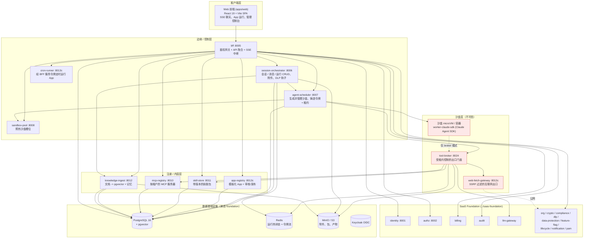
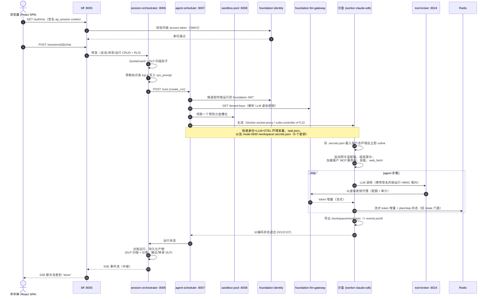

[English](ARCHITECTURE.md) | 中文

# Agent Platform 架构指南

Agent Platform 在按运行隔离的 microVM（微虚拟机）中执行不可信的、由模型生成的 agent 代码，
并为每次运行提供一个默认拒绝（default-deny）的网络与单一的受控出口路径。它**构建于**
[SaaS Foundation](https://github.com/chenzefeng09/saas-foundation) **之上**，由后者提供身份、
鉴权、计费、审计与 LLM 网关能力。本文档是系统级指南：分层结构、端到端运行生命周期、每个服务的
参考、agent 运行时契约、沙盒运行时、安全模型，以及部署拓扑。

> **与 SaaS Foundation 的关系。** Agent Platform 引入 `foundation_sdk`，并调用 Foundation 服务
> 处理身份/鉴权/计费/审计/LLM 网关。它要求在 `../saas-foundation` 处有一个并列检出的
> `saas-foundation` 仓库。SaaS Foundation 是一个独立、可复用的企业级底座，可被任何业务系统使用；
> Agent Platform 即是这样一个业务系统。参见
> [agent-platform 仓库](https://github.com/chenzefeng09/agent-platform) 与
> [saas-foundation 仓库](https://github.com/chenzefeng09/saas-foundation)。

## 目录

- [分层总览](#分层总览)
- [端到端运行生命周期](#端到端运行生命周期)
- [服务参考](#服务参考)
- [Agent 运行时](#agent-运行时)
- [沙盒运行时](#沙盒运行时)
- [安全与隔离模型](#安全与隔离模型)
- [部署拓扑](#部署拓扑)
- [延伸阅读](#延伸阅读)

## 分层总览

平台分为五层。浏览器只与 BFF 通信；BFF 与平台服务调用 SaaS Foundation 处理横切关注点；agent 代码
在隔离沙盒中运行，且（在 broker 出口模式下）**只能**经由 tool-broker 门面访问系统其余部分。

> **端口表示法。** `:8013c` 标记那些**容器**端口为 `8013`、但**开发 compose 主机**端口不同的服务，
> 以避免与 Foundation 审计服务（容器端口同为 `8013`）冲突。主机映射为：`app-registry` 主机
> `8014`、`cron-runner` 主机 `8015`、`web-fetch-gateway` 主机 `8023`。准确值见
> [服务参考](#服务参考)。

**各层职责**

| 层 | 负责 | 信任 |
|---|---|---|
| 客户端 | React SPA、SSE 聊天渲染、App 运行/结果 UI、`/admin/*` 治理控制台 | 浏览器，经签名 cookie 鉴权 |
| 边缘 / 控制 | 会话终点、运行生命周期、沙盒调度、池预热、定时任务 | 可信，持有基础设施凭据 |
| 注册 / 内容 | App、技能、MCP 服务器、知识/记忆 | 可信，经 RLS 按租户隔离 |
| 沙盒 | agent 本身及其出口门面 | **不可信** —— 运行模型生成的代码 |
| Foundation + 数据 | 身份、鉴权、计费、审计、LLM 网关与共享数据存储 | 可信，独立仓库 |

## 端到端运行生命周期

下面的时序图叙述一次从浏览器到 `done` SSE 事件的完整聊天/运行，遵循平台数据流。处于
**broker 出口模式**（默认）的步骤会把每个沙盒调用都经由 tool-broker 路由；沙盒本身不持有任何基础
设施凭据。

逐步说明：

1. **会话。** 浏览器持有 BFF 签名的 `ap_session` cookie。`AuthGate` 调用 BFF `/auth/me`，后者将内嵌
   的 access token 转发给 Foundation identity 做 JWKS 校验。
2. **聊天/运行请求。** SPA 向 BFF（鉴权网关 + API 聚合 + SSE 中继）发起 POST，BFF 转发给
   **session-orchestrator** 在 RLS 下完成会话/消息/运行 CRUD。orchestrator 负责 DLP
   `check:download` / 扫描钩子，用计费 `QuotaGuard` 强制配额，并预取租户知识库的 top-k 命中追加到
   该运行的 `sys_prompt`。
3. **create_run。** orchestrator（经 scheduler 路径）铸造一个短时按运行的 Foundation JWT 并调用
   **agent-scheduler**。
4. **解析 + 生成。** scheduler 解析租户 LLM 虚拟密钥（`llm-gateway GET /tenant-keys`；解析不到即令生成失败），并经所选的
   `SandboxRuntime` 实现（Docker 经 docker-socket-proxy，或 Cube 经 cube-controller 在 `:8443` 上的
   mTLS）从一个预热 **sandbox-pool** 槽位生成沙盒。它投递身份 + LLM + OTEL 环境变量、`task.json`
   （`{task, mcp_server_ids, skills, files, sys_prompt, …}`），以及一个 mode-`0600` 的
   `/workspace/.secrets.json`，承载 6 个控制面密钥。
5. **构建 agent。** 在沙盒内，Claude SDK worker 载入并立即 unlink 该密钥文件，启动本地网关适配器，
   组装系统提示，从 `mcp-registry` 拉取租户 MCP 服务器，索引挂载在 `/home/skills` 下的技能，并注册
   进程内 `web_fetch` 工具。
6. **运行（broker 出口）。** 在 broker 模式下，沙盒**只能**访问 tool-broker 门面 + DNS。LLM 调用走
   `SDK -> adapter.ts -> tool-broker -> Foundation llm-gateway`（虚拟密钥 + 配额 + 审计）；Redis
   热状态/令牌流与 S3 产物走 tool-broker 的 `/state` 与 `/s3` 门面；网页抓取走
   `web_fetch -> web-fetch-gateway`（SSRF 过滤）。每个调用都携带签名的按运行租约。
7. **持久化 + 退出。** worker 将 token 增量 + plan/step 状态流入 Redis，写出
   `/workspace/result.json`（+ `events.jsonl`），并以编码状态退出。
8. **对账 + 中继。** scheduler 轮询运行状态；orchestrator 对账完成（`reconcile_sweeper`），持久化
   产物（DLP 扫描 + 分类标签），施加输出/转录 DLP，并把 SSE 流经 BFF 中继回浏览器直到 `done`。
   **cron-runner** 可经 BFF 服务令牌按计划驱动 App 运行。

## 服务参考

Agent Platform 由 11 个服务组成。除非另有说明，均为 Python 3.12（FastAPI + uvicorn，Poetry），且
多数引入 `foundation_sdk` 提供请求上下文与 RFC-7807 problem-details。标注**容器 `8013`** 的端口在
开发 compose 中使用不同的**主机**端口（括号内给出），以避免与 Foundation 审计服务冲突。

| 服务 | 端口（容器 / 开发主机） | 一句话 |
|---|---|---|
| [bff](#bff) | 8005 | 鉴权网关、cookie 会话、API 聚合、SSE 中继 |
| [session-orchestrator](#session-orchestrator) | 8006 | 会话 / 消息 / 运行生命周期、附件、知识预取、运行 SSE |
| [agent-scheduler](#agent-scheduler) | 8007 | 按运行生成并管理沙盒 |
| [sandbox-pool](#sandbox-pool) | 8008 | 预热空闲沙盒槽位 |
| [skill-store](#skill-store) | 8011 | 带版本的技能包注册 |
| [mcp-registry](#mcp-registry) | 8010 | 按租户的 MCP 服务器注册 |
| [knowledge-ingest](#knowledge-ingest) | 8012 | 文档 → pgvector 摄取 + 语义搜索 |
| [app-registry](#app-registry) | 8013 / 8014 | 模板化 App，带审核/发布 |
| [cron-runner](#cron-runner) | 8013 / 8015 | 经 BFF 定时运行 App |
| [web-fetch-gateway](#web-fetch-gateway) | 8013 / 8023 | SSRF 防护的出站 HTTP 抓取 |
| [tool-broker](#tool-broker) | 8024 | 面向沙盒的受租约控制出口门面 |

### bff

**Backend-for-frontend —— 端口 8005。** FastAPI 标题 *Agent Platform — BFF*，API 前缀
`/api/bff/v1`。它终结浏览器会话（经 `foundation_sdk.CookieSigner` + `SessionMiddleware` 的签名
`ap_session` cookie），针对 identity-service 暴露 login/logout/me，并向每个平台与 Foundation 服务
扇出、聚合并中继响应（含 SSE 聊天流）。它有一个小型 BFF 本地库（`agent_bff` schema）存放通知偏好
与 API 密钥，并接受共享的 `X-Service-Token` 供 `cron-runner` 等机器调用方使用。

- **关键端点：** `POST /auth/login`、`GET /auth/me`、`POST /auth/logout`；
  `GET/POST /sessions`、`POST /sessions/{session_id}/chat`、
  `GET /sessions/{session_id}/stream`（SSE）；`GET/POST /apps`、
  `POST /apps/{app_id}/run`；`GET/POST /library/{mcp-servers,skills,documents}`；
  `GET /fleet/{pool,sandboxes,topology}`；`GET/POST /schedules`；
  `GET/POST/DELETE /api-keys`；`GET .../admin/*`（针对 authz、org、identity、sso、billing、model、
  audit、flags、platform、notification、api-platform、pam、dlp、compliance、security-ops、
  lifecycle、data-protection、large-attachment、metrics 的治理代理）；`GET /healthz`。
- **依赖：** `foundation_sdk`；session-orchestrator、agent-scheduler、sandbox-pool、app-registry、
  mcp-registry、skill-store、knowledge-ingest、cron-runner；Foundation identity / authz / org /
  billing / audit / feature-flag / llm-gateway / notification / api-platform / pam / dlp /
  compliance / security-ops / lifecycle / data-protection；Postgres（`agent_bff` schema）。

### session-orchestrator

**拥有会话 / 消息 / 运行生命周期 —— 端口 8006。** FastAPI 标题 *Agent Session Orchestrator*，API
前缀 `/api/session/v1`。它在自有的 `session_orchestrator` Postgres schema 中持久化会话、消息与运行，
把附件存入 S3/MinIO，并从 Redis 读取 agent 运行热状态（plan/step/cursor）。它通过调用 agent-scheduler
启动运行，运行会话保留清扫与运行对账的后台循环，并以计费 `QuotaGuard` 加附件路径上的 DLP 检查来强制
配额。每次运行都派发到沙盒：`execution_mode` 仍在运行上存储并返回（兼容历史行），但传入的 `inline`
会被强制改为 `sandbox`。

- **关键端点：** `GET/POST /sessions`、`GET/PATCH/DELETE /sessions/{session_id}`；
  `GET/POST /sessions/{session_id}/messages`；`POST /sessions/{session_id}/runs`、
  `GET /sessions/{session_id}/runs/{run_id}/state`、
  `GET /sessions/{session_id}/runs/{run_id}/events`（SSE）、
  `POST /sessions/{session_id}/runs/{run_id}/cancel`；
  `POST/GET /sessions/{session_id}/attachments`、
  `GET /sessions/{session_id}/files/{file_id}/content`；
  `GET /runs/token-usage/daily`；`GET /healthz`。
- **依赖：** `foundation_sdk`；agent-scheduler；knowledge-ingest（记忆与知识库 top-k 预取、记忆回写）；Foundation
  authz / billing / feature-flag / dlp；Postgres；Redis（运行热状态）；S3/MinIO（附件）。

### agent-scheduler

**生成并管理沙盒 —— 端口 8007。** FastAPI 标题 *Agent Scheduler*，API 前缀 `/api/scheduler/v1`。它在
启动时构建可插拔沙盒运行时（`docker` 或 `cube`），并在 `POST /runs` 时从 Foundation identity 铸造一个
按运行的、限定作用域的租户令牌，签发一个 HMAC tool-broker 能力租约，并以配置的出口模式（`broker` /
`foundation` / `none`）经 docker-socket-proxy 启动沙盒。每个沙盒都运行 Claude SDK 镜像
（`AGENT_IMAGE` / `SCHEDULER_AGENT_IMAGE`）；scheduler 转发注册/网关 URL，投递租户 LLM 虚拟密钥
（解析不到即令生成失败），并以 `QuotaGuard` 强制计费配额。

- **关键端点：** `POST /runs`、`GET /runs`、`GET /runs/{run_id}`、`POST /runs/{run_id}/cancel`、
  `GET /runs/{run_id}/events`（SSE）；`GET /sandboxes`、`POST /sandboxes/{sandbox_id}/stop`；
  `GET /healthz`。
- **依赖：** `foundation_sdk`；`feature-flag-client`；docker-socket-proxy（无直接 `docker.sock`）；
  tool-broker（门面 URL + 共享 HMAC 租约密钥）；session-orchestrator、mcp-registry、skill-store、
  web-fetch-gateway；Foundation identity / keycloak / authz / billing / feature-flag / llm-gateway；
  Redis、S3/MinIO（转发进沙盒）。

### sandbox-pool

**预热空闲沙盒槽位 —— 端口 8008。** FastAPI 标题 *Sandbox Pool*，API 前缀
`/api/sandbox-pool/v1`。一个内存中的 `Pool` 类维护低/高空闲水位线与最大总量上限，由 lifespan 中周期性
的 warmup/reap 计时器驱动；它经 docker-socket-proxy 启停沙盒容器，并将其接入内部 `sandbox_broker`
网络。它暴露 Prometheus `/metrics` ASGI 挂载（按 app 的 `CollectorRegistry`）。生产环境用 KEDA 驱动的
operator 替换内存中的骨架实现。

- **关键端点：** `POST /sandboxes`（领取/签出）、`DELETE /sandboxes/{...}`、
  `GET /sandboxes/_pool`（池状态）；`GET /healthz`；`GET /metrics`（Prometheus）。
- **依赖：** `foundation_sdk`；docker-socket-proxy；`prometheus-client`；CubeSandbox 控制器
  （`SANDBOX_POOL_CUBE_CONTROLLER_URL`，开发环境可选）。

### skill-store

**带版本的技能包注册 —— 端口 8011。** FastAPI 标题 *Skill Store*，API 前缀 `/api/skills/v1`。它在
Postgres 中管理技能元数据，并把带版本的技能 tarball 存入可插拔的 blob 后端（默认 S3/MinIO，测试用内存）。
它支持列出/安装/卸载技能、上传新版本、下载版本 tarball，以及内部解析端点（`skill.read_internal`
作用域），供 scheduler 用内容寻址方式将技能绑定挂载进沙盒。计费经 `QuotaGuard` 强制。

- **关键端点：** `GET /skills`、`GET /skills/installed`、`GET/DELETE /skills/{skill_id}`、
  `GET /skills/{skill_id}/versions`、`GET /skills/{skill_id}/versions/{version}/download`；
  `GET /internal/skills`、`/internal/skills/resolve`；`GET /healthz`。
- **依赖：** `foundation_sdk`；`feature-flag-client`；Foundation authz / billing / feature-flag；
  Postgres；S3/MinIO（技能 tarball）。

### mcp-registry

**按租户的 MCP 服务器注册 —— 端口 8010。** FastAPI 标题 *MCP Registry*，API 前缀 `/api/mcp/v1`。它在
Postgres（`public` schema）中提供按租户作用域的 MCP 服务器记录 CRUD，并暴露一个由
`mcp.read_internal` 服务作用域守护的内部列表端点，供沙盒内 worker（经
tool-broker）调用，为每次运行加载租户的 MCP 服务器。

- **关键端点：** `GET/POST /mcp-servers`、`GET /mcp-servers/{server_id}`、
  `PATCH /mcp-servers/{server_id}`、`DELETE /mcp-servers/{server_id}`；
  `GET /internal/mcp-servers`（`mcp.read_internal` 作用域）；`GET /healthz`。
- **依赖：** `foundation_sdk`；Foundation authz；Postgres。

### knowledge-ingest

**文档 → 嵌入 → pgvector 流水线 —— 端口 8012。** FastAPI 标题 *Knowledge Ingest*，API 前缀
`/api/knowledge/v1`。它摄取上传的文档（存入可插拔 blob 后端：S3/MinIO 或内存），经可插拔客户端
（默认本地，或 Foundation llm-gateway）生成嵌入，并用 `pgvector` 扩展把向量写入 Postgres。它提供文档
CRUD 与向量 `/search` 端点，供 session-orchestrator 用于记忆与知识预取以及记忆回写。计费经 `QuotaGuard` 强制。

- **关键端点：** `GET/POST /documents`（摄取）、`GET /documents/{document_id}`、
  `DELETE /documents/{document_id}`、`POST /documents/{document_id}/...`（重新摄取）；
  `GET /search`（向量搜索）；`GET /healthz`。
- **依赖：** `foundation_sdk`；Foundation authz / billing / llm-gateway（嵌入后端）；
  Postgres + pgvector；S3/MinIO（文档）。

### app-registry

**模板化 App，带审核/发布 —— 容器端口 8013（开发主机 8014）。** FastAPI 标题 *App Registry*，API 前缀
`/api/apps/v1`。它在自有 `app_registry` Postgres schema（带 RLS，由其 Alembic env 拥有）中存储 App 与
AppVersion，并管理 App 生命周期：创建/更新 app、创建版本、提交审核、批准/驳回与发布。它还暴露受服务
作用域守护的 `/internal` 解析路由，供 BFF 运行解析器与 scheduler 查询已发布的 App harness。

> **端口说明。** 容器端口 `8013` 与 Foundation 审计服务冲突，故开发 compose 映射到主机端口 `8014`。

- **关键端点：** `GET/POST /apps`、`GET/PUT/DELETE /apps/{app_id}`、
  `POST /apps/{app_id}/versions`、`PUT /apps/{app_id}/versions/{vid}`、
  `POST .../versions/{vid}/submit`、`/approve`、`/reject`、`/publish`（审核流程）；
  `GET .../internal` 解析（受服务作用域守护）；`GET /healthz`。
- **依赖：** `foundation_sdk`；Foundation authz；Postgres（`app_registry` schema）。

### cron-runner

**定时 App 执行 —— 容器端口 8013（开发主机 8015）。** FastAPI 标题 *Cron Runner*，API 前缀
`/api/cron/v1`；使用 APScheduler。启动时它拉起一个 `AsyncIOScheduler` 并从其 `cron_runner` Postgres
schema 载入所有持久化的已启用 cron 任务，随后通过用共享服务令牌（`BFF_SERVICE_TOKEN`）调用 BFF 来触发
每个计划内的 App 运行。它暴露 cron 任务 CRUD 与标准健康端点。

> **端口说明。** 容器端口 `8013` 与 `web-fetch-gateway` 的容器端口冲突；二者通过不同的开发 compose
> 主机映射（`8015` 对 `8023`）区分。与多数服务不同，cron-runner 是一个纯 FastAPI 应用，**不**使用
> `foundation_sdk`（无 `install_request_context`）。

- **关键端点：** `GET/POST /cron-jobs`、`PATCH /cron-jobs/{job_id}`、`DELETE /cron-jobs/{job_id}`；
  `GET /healthz`、`/readyz`。
- **依赖：** bff（经 `BFF_SERVICE_TOKEN` 执行 App）；`apscheduler`；Postgres（`cron_runner` schema）。

### web-fetch-gateway

**SSRF 防护的出站抓取 —— 容器端口 8013（开发主机 8023）。** FastAPI 标题 *Web Fetch Gateway*，API
前缀 `/api/web-fetch/v1`。agent（经 tool-broker）向 `/fetch` POST 一个 URL，网关在把请求转发到公网之前
强制执行域名白名单（为空时 fail-closed）、私网段 / 元数据 IP 的 SSRF 阻断、内容类型限制、最大响应大小与
抓取超时。它要求鉴权（`WEB_FETCH_REQUIRE_AUTH`）与 `web_fetch.invoke` 作用域，且是**唯一**接入出站
`egress` 网络的服务。

> **端口说明。** 容器端口 `8013` 在开发 compose 中映射到主机 `8023` 以避开 Foundation 审计服务。该包
> 的 `ruff` 目标为 py311。

- **关键端点：** `POST /fetch`；`GET /healthz`、`/readyz`。
- **依赖：** `httpx`（出站抓取）；tool-broker / agent 沙盒（调用方）。无 `foundation_sdk`，无数据库；
  依赖仅限 fastapi/uvicorn/pydantic/httpx。

### tool-broker

**受租约控制的出口门面 —— 端口 8024。** FastAPI 标题 *Tool Broker*，API 前缀
`/api/tool-broker/v1`，因仅有不可信沙盒可触达，其 OpenAPI/docs 已禁用、`Server` 头被剥除。每个请求都必须
携带一个 HMAC 按运行租约（由 scheduler 用共享租约密钥签发），它会校验其租户/用户/run-id/作用域/有效期；
它剥除沙盒提供的身份头，仅重新注入由租约证明的身份。它代理 llm-gateway、mcp-registry、skill-store 与
web-fetch-gateway 的路径白名单子集，并以沙盒永不可见的凭据暴露 Redis 热状态（`/state/v1`）与只读、按租户
作用域的 S3（`/s3/v1`）门面。

- **关键端点：** `POST /state/v1/set`、`GET /state/v1/get`、`POST /state/v1/xadd`；
  `GET /s3/v1/object`；`* /llm-gateway/v1/{path}`（精确：`chat/completions`）；
  `* /mcp/v1/{path}`（精确：`internal/mcp-servers`）；`* /skills/v1/{path}`（前缀：
  `internal/skills`）；`* /web-fetch/api/web-fetch/v1/{path}`（精确：`fetch`）；`GET /healthz`。
- **依赖：** agent-scheduler（签发其校验的 HMAC 租约；共享 `TOOL_BROKER_LEASE_SECRET`）；Foundation
  llm-gateway；mcp-registry；skill-store；web-fetch-gateway；Redis（state 门面）；S3/MinIO（s3 门面）。
  它有意**不**使用 `foundation_sdk` —— 仅 fastapi/httpx/redis/boto3。

## Agent 运行时

Agent 运行时是 [`worker-claude-sdk/`](../worker-claude-sdk/) 中的
**[Claude Agent SDK](https://docs.claude.com/en/api/agent-sdk/overview)** worker —— 一个
TypeScript/Node 22 程序，也是平台中**唯一**的 agent 循环。每次运行（聊天或 App）都是一次沙盒内的
Claude SDK 运行；不存在进程内（"inline"）执行路径。决策见
[ADR 0003](adr/0003-claude-agent-sdk-sole-agent-runtime.md)（它取代了选择 AgentScope 的
[ADR 0002](adr/0002-agent-kernel-agentscope-over-openhands.md)）。

集成形态是**一沙盒一 agent、一 agent 一任务**。长驻的多租户 agent 服务会破坏按运行的 microVM 隔离
边界，因此每次运行都是一个一次性 worker，可干净地映射到一条 `run` 行以便审计与计费。

### worker-claude-sdk 模块

| 模块 | 作用 |
|---|---|
| `main.ts` | 入口（`node /app/dist/main.js`）：载入并 unlink `.secrets.json`，校验必需环境变量，启动网关适配器，执行查询，写出 `result.json`，以编码状态退出。 |
| `adapter.ts` | 进程内 HTTP 适配器，SDK 经 `ANTHROPIC_BASE_URL=http://localhost:<port>` 访问它。在 Anthropic Messages 与 Foundation llm-gateway 的 OpenAI 兼容 `chat/completions` 之间双向转换（流式、工具调用、thinking、结构化输出），并注入 `Authorization: Bearer <按运行 foundation JWT>`、`X-Tenant-Id`、`X-User-Id`、`X-LLM-Virtual-Key`，broker 模式下另带 `X-Tool-Broker-Lease`。 |
| `worker.ts` | 运行循环：把附件下载到 `/workspace/inputs`，组装系统提示（续跑说明、记忆、历史、含预取知识命中的 `sys_prompt`、技能索引），从 `mcp-registry` 解析租户 MCP 服务器，注册进程内 `web_fetch` 工具（经 web-fetch-gateway），并驱动 SDK `query()`。 |
| `event_translator.ts` | 把 SDK 消息流转换为平台事件词汇（`events.jsonl` + Redis 令牌流）。 |
| `hitl.ts` | 人在回路的暂停/续跑（`pending_confirmation` / `pending_question`）。 |
| `dlp.ts` | 调用 Foundation DLP `core/scan` 的 `PreToolUse` 钩子（fail-open）。 |
| `redis_state.ts` | 热状态 + 令牌流写入（直连，或经 tool-broker `/state` 门面）。 |

**知识库。** orchestrator 为每次运行预取租户知识库的 top-k 命中，并追加到 worker 的 `sys_prompt`。
沙盒内暂无按需检索知识库的工具。

**相对已移除的 AgentScope worker 的已知差距**（见 ADR 0003）：没有画布工具（agent 不能创建画布）、
没有按需知识检索工具、没有沙盒内审计 sink。

### Worker 契约

沙盒入口从文件/环境变量读取任务，并通过文件、Redis 与退出码报告结果。该契约是**承重的**：两种沙盒运行时
（docker、cube）都依赖它。完整线上格式见
[`contracts/worker-wire-contract.md`](../contracts/worker-wire-contract.md)。

| 方向 | 产物 | 说明 |
|---|---|---|
| **入** | `/workspace/task.json`（docker）或 `AGENT_TASK_JSON` 环境变量（cube） | `{ task, mcp_server_ids, skills, files, memory, history, sys_prompt, … }` 加按运行的 model/reasoning/sampling 覆写 |
| **入** | Foundation 环境变量 | `FOUNDATION_API_URL`、`FOUNDATION_TENANT_ID`、`FOUNDATION_USER_ID`、注册/网关 URL、`LLM_MODEL`、OTEL 配置 |
| **入** | `/workspace/.secrets.json`（mode `0600`） | 6 个白名单控制面密钥；载入 worker 的 `process.env` 后即 **unlink** |
| **出** | `/workspace/result.json` | scheduler 读取的运行结果 |
| **出** | `/workspace/events.jsonl` | 每个平台事件一行 JSON（磁盘日志在网关故障时仍保留） |
| **出** | Redis 热状态 + 令牌流 | plan/step/cursor + 流式 token 增量（broker 模式下经 `/state` 门面） |
| **出** | 退出码 | 编码状态（见下） |

**编码退出状态**

| 码 | 含义 |
|---|---|
| `0` | 运行结束（OK、FAILED 或 paused 记录在 `result.json` 中） |
| `1` | 基础设施错误（缺必需环境变量、worker 崩溃） |
| `2` | 错误任务（缺失 / 畸形载荷） |
| `137` | OOM（被杀） |

**安全加固。** worker 把 `/workspace/.secrets.json` 读入自身 `process.env` 后即 **unlink** 该文件，并在
任何工具子进程运行前清理控制面环境变量 —— 使密钥不出现在 `/proc/1/environ`，也不留在 agent 的
`Read`/`Bash` 工具可见的可写工作区中。

## 沙盒运行时

三个实现位于 `SandboxRuntime` 协议之后（`spawn_run` / `get_run_status` /
`get_container_tenant` / `cancel_run` / `list_containers`），由 `SCHEDULER_RUNTIME` 环境变量选择。三者都
运行**同一 OCI 镜像**与**同一 worker 契约**，因此切换运行时是一行配置变更 —— 其理由与风险表见
[ADR 0001](adr/0001-sandbox-runtime-cube-default-kata-fallback.md)。

| 运行时 | `SCHEDULER_RUNTIME` | 隔离 | 角色 | 说明 |
|---|---|---|---|---|
| **CubeSandbox** | `cube` | microVM（E2B HTTP 协议） | **默认（生产）** | P95 冷启动约 90 ms，到 `cube-controller:8443` 的 mTLS，需要 `/dev/kvm` |
| **Kata Containers** | `kata` | microVM（Kata + Cloud Hypervisor） | 回退 | 万一 CubeSandbox 不行时的有界逃生口（ADR 0001） |
| **Docker** | `docker` | 兄弟容器（共享主机内核） | 开发 / CI | 经 docker-socket-proxy；贡献者无需 KVM |

> **逃生口始终是 `SCHEDULER_RUNTIME` 环境变量。** 没有任何 CubeSandbox 特有概念泄漏进 agent-scheduler
> 或 sandbox-pool 的业务逻辑；一切都经 `SandboxRuntime` 抽象。由于沙盒镜像面向 OCI 规范（而非
> CubeSandbox 特有格式），切换后同一镜像可在 Kata 上运行。

## 安全与隔离模型

安全是分层的，任何单一控制都不承重。按运行的 microVM 是租户隔离 + 审计 + 计费边界；broker 是唯一出口；
租约与铸造的令牌把每个调用限定到单次运行。

- **内核级隔离。** 不可信的、模型生成的代码在 CubeSandbox microVM（默认）或 Kata microVM（回退）中运行
  —— 而非共享主机内核的容器；Docker 仅用于开发/CI。一沙盒一 agent、一 agent 一任务 —— 按运行的 microVM
  是租户隔离 + 审计 + 计费边界（[ADR 0001](adr/0001-sandbox-runtime-cube-default-kata-fallback.md) /
  [ADR 0003](adr/0003-claude-agent-sdk-sole-agent-runtime.md)）。不存在进程内执行路径：工具调用从不在
  orchestrator 内运行。
- **默认拒绝出口。** 在 broker 模式下，沙盒只接入内部 `sandbox_broker` 网络，且**只能**访问 tool-broker
  门面 + DNS。已验证被拒集合包括 Redis、MinIO、Keycloak、mcp-registry、公网、云元数据
  `169.254.169.254` 以及其他 RFC-1918 段。在 microVM 层经 CubeVS（eBPF `allow_out` 叠加，
  `allow_internet_access=false`）强制，并以主机 `nftables` 回退；空白名单会让生成 **fail-close**。
- **按运行能力租约。** scheduler 用 broker 与 scheduler 共持的密钥签发一个签名的 HMAC 按运行租约
  （`TOOL_BROKER_LEASE`）；每个 tool-broker 调用（LLM / MCP / skills / web-fetch / state / s3）都必须
  携带它。真实基础设施凭据（Redis 密码、MinIO 密钥）**只**存在于 broker —— 沙盒一概不持有。
- **按运行令牌铸造。** `create_run` 按运行铸造一个短时、限定作用域的 Foundation JWT
  （`FOUNDATION_API_TOKEN`）注入沙盒；scheduler 经 Keycloak OIDC `client_credentials` 自举其自身的
  服务账号令牌。令牌预期在运行结束 / TTL 到期时被吊销。
- **密钥投递加固。** 6 个控制面密钥被写入 mode-`0600` 的 `/workspace/.secrets.json`（白名单键：
  `FOUNDATION_API_TOKEN`、`TOOL_BROKER_LEASE`、`LLM_VIRTUAL_KEY` 等），由 worker 载入 `process.env`
  后立即 unlink —— 既不在容器的 `environment=` 块或 `/proc/1/environ` 中，也从 agent 的
  `Read`/`Bash` 工具可见的可写工作区中移除。
- **LLM 网关强制。** worker 的 `adapter.ts` 用租户虚拟密钥（配额 + 审计 + 模型路由）将所有沙盒 LLM
  流量经 Foundation llm-gateway 路由。Agent 栈中不存在任何 provider API 密钥，缺失虚拟密钥会
  **令生成失败**。按运行的沙盒令牌不含 `audit.write`。
- **DLP（真实防线，而非测试页）。** 一个默认全局正则规则库（身份证 / 电话 / 银行卡 / 邮箱 / AWS 密钥 /
  私钥 / api-key，敏感度 L2–L4）驱动强制：session-orchestrator 在送出字节前强制 `check:download`，并在
  上传与运行产物持久化时 `scan` + 自动分类；输出/转录 DLP 在运行完成路径上执行。扫描结果持久化到
  `dlp_event`，并加上 Prometheus 计数器与管理治理面板。
- **网页出口 SSRF 控制。** `web-fetch-gateway` 是唯一互联网出口服务，强制域名白名单（空 = fail-closed）、
  私网段 + 元数据 IP 阻断、内容类型限制、大小上限与作用域鉴权（`web_fetch.invoke`）。
- **tool-broker 纵深防御。** broker 在边界处剥除客户端注入的身份头（`X-Tenant-Id` 等），要求租约 + 鉴权
  （启动守卫拒绝占位租约密钥），强制上游路径白名单，禁用 OpenAPI/docs，剥除 `Server` 头，并使用最小权限
  上游作用域。
- **Docker 运行时最小权限。** scheduler 仅经 docker-socket-proxy 触达 Docker（无 `/var/run/docker.sock`
  绑定挂载）；`exec` / `volumes` / `privileged` 动词被拒；容器 cap 被丢弃，配以 2 GB 内存 / cpu-share /
  600 s 超时限制；沙盒 S3 桶被锁定。
- **镜像供应链。** 非 root agent 用户（uid 1000），Cube 镜像固定基础 digest，并以 `npm ci` 按提交的锁文件安装，cosign 签名 +
  syft SBOM 为**计划中**。合规控制（审计轨迹、microVM 隔离、镜像完整性、按运行数据最小化）在沙盒运行时
  设计文档中映射。

## 部署拓扑

同一套镜像跑遍开发、预发与 Kubernetes；变化的是 `SCHEDULER_RUNTIME` 与出口强制层。

### 本地开发 —— docker-compose，`SCHEDULER_RUNTIME=docker`

`make up` 拉起 saas-foundation 开发栈，然后是 `deploy/docker-compose/agent-platform.yml`。沙盒是经
docker-socket-proxy 生成的兄弟 Docker 容器（最小权限：仅 containers/images/networks；exec/volumes/
privileged 被拒）。默认 broker 出口模式：沙盒接入内部 `sandbox_broker` 网络，`web-fetch-gateway` 是唯一
具有互联网访问的服务（出口桥）。端口：BFF 8005、orchestrator 8006、scheduler 8007、pool 8008、
tool-broker 8024、web-fetch 主机 8023、web 5173。**无需 KVM。**

### 预发 —— CubeSandbox microVM

在带 `/dev/kvm` 的 Linux 主机上，将 `agent-platform.cube.yml` 叠加在基础文件之上。它加入 `cube-controller`
（占位 `CUBE_CONTROLLER_IMAGE`，特权，KVM 设备），设置 `SCHEDULER_RUNTIME=cube` + mTLS
（`gen-cube-certs.sh` 生成 ca/controller/scheduler-client 证书；`check-cube-preflight.sh` 把守切换）。沙盒
变为 E2B 协议 microVM；按 VM 出口经 CubeVS `allow_out`（`deploy/cube/sandbox-broker-only.policy.yaml`）或
主机 `nftables` 回退强制。参见 [enable-cubesandbox 运行手册](runbook/enable-cubesandbox.md)。

### Kubernetes —— Helm（small / medium / large）

`helm install agent-platform deploy/helm/agent-platform -f values-{small|medium|large}.yaml`。foundation
子 chart 可选（默认关闭，假定共享 foundation）。

| 档位 | 运行时 | 伸缩 | 附加 |
|---|---|---|---|
| `small` | docker | 固定副本 | 基线 |
| `medium` / `large` | cube | 基于 `sandbox_pool_idle` 的 KEDA 自动伸缩（`deploy/operator`） | PDB、拓扑分散、nginx ingress |

应用了加固的 Pod 安全上下文（`runAsNonRoot` 10001、丢弃全部 cap、`readOnlyRootFilesystem`、
`RuntimeDefault` seccomp）。**沙盒不是 Pod**，因此沙盒 `NetworkPolicy` 有意不渲染 —— 隔离来自 broker URL
重写（仓库内）加 CubeSandbox 控制器的按 VM 策略（仓库外）。

### 备份 / 容灾 + 压测

`deploy/backup/{backup,restore,verify-restore}.sh` 覆盖 Postgres（foundation/keycloak/unleash）+ MinIO
（agent-platform + audit-WORM）+ Vault KEK，目标 RTO < 30 分钟 / RPO < 1 小时。`deploy/loadtest`（Locust）
模拟 BFF 登录 → 会话 → 聊天-SSE 旅程，带 TTFT / 总时延 SLO。

## 延伸阅读

- **[ADR 0001 —— 沙盒运行时：CubeSandbox 默认、Kata 回退](adr/0001-sandbox-runtime-cube-default-kata-fallback.md)** —— 为何 CubeSandbox 为默认、Kata 为回退，`SandboxRuntime` 逃生口环境变量，以及风险表。
- **[ADR 0003 —— Claude Agent SDK 作为唯一 Agent 运行时](adr/0003-claude-agent-sdk-sole-agent-runtime.md)** —— 为何收敛到单一 worker、移除了什么（AgentScope、inline 模式）、已知差距与回滚方式。
- **[ADR 0002 —— Agent 内核：AgentScope，而非 OpenHands](adr/0002-agent-kernel-agentscope-over-openhands.md)** —— *已被 ADR 0003 取代*；作为最初内核选择的历史记录保留。
- **[Worker 线上契约](../contracts/worker-wire-contract.md)** —— `task.json`、`.secrets.json`、Redis 令牌流、`result.json`、暂停状态、平台 SSE 事件以及出口 / tool-broker 契约。
- **[沙盒运行时设计](design/b-m2-sandbox-runtime-v1.md)** —— `SandboxRuntime` 协议、运行状态机、池水位线、部署档位与合规映射（按 AgentScope worker 撰写；运行时层面的契约仍然成立）。
- **[沙盒镜像 README](../sandbox-images/README.md)** —— `claude-sdk*` 镜像（各自承载内容）、MATLAB 分层与构建流程。
- **[CubeSandbox 出口隔离 README](../deploy/cube/README.md)** —— 按 microVM 的出口隔离：CubeVS `allow_out` 叠加对主机 `nftables` 回退、RFC-1918 硬拒绝的注意点，以及隔离验证清单。

## 许可证

Agent Platform 以 **Apache-2.0** 许可。参见 [LICENSE](../LICENSE) 与 [NOTICE](../NOTICE) 文件。
版权所有 © 2026 The Agent Platform Authors。

安全报告请联系 **chenzefeng09@gmail.com**。
