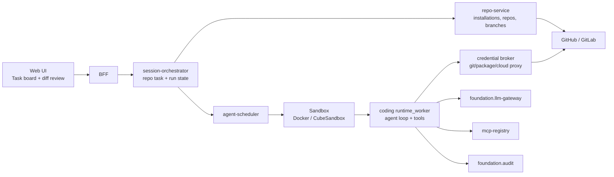
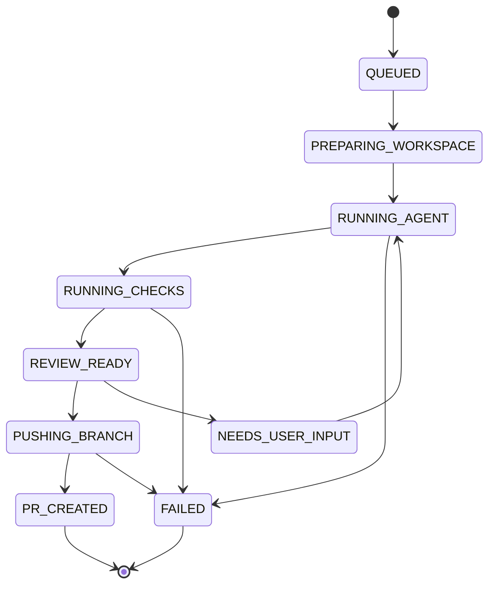

# Claude Code Web Gap Plan

> **Note (2026-10):** this roadmap predates [ADR 0003](../adr/0003-claude-agent-sdk-sole-agent-runtime.md).
> AgentScope and `agentscope_ext` have been removed; read references to them
> below as "the agent worker", which is now the Claude Agent SDK worker
> (`worker-claude-sdk/`).

> Status: draft roadmap
>
> Goal: move agent-platform from a generic isolated cloud agent runtime to a
> repo-aware cloud coding agent product, comparable to Claude Code Web / Codex
> Cloud in developer workflow.

## 1. Positioning

agent-platform already has the harder runtime primitive: every run can execute
inside a Docker or CubeSandbox-backed isolated sandbox, with tenant context,
short-lived foundation token, LLM gateway enforcement, MCP registry injection,
Skills loading, audit events, and BFF/orchestrator/scheduler separation.

The current product shape is still closer to "chat starts an isolated agent
run". Claude Code Web's product shape is "developer delegates a repository task,
the service clones the repo, prepares the environment, lets the agent edit and
test code, then returns a branch, diff, logs, and pull request".

This roadmap closes that product gap without changing the core platform
premise: one task, one sandbox, one scoped credential set, explicit audit.

## 2. Current Strengths To Preserve

- [ ] Keep per-run sandbox isolation as the security boundary.
- [ ] Keep foundation-issued short-lived token as the only platform credential
  visible to the sandbox.
- [ ] Keep LLM calls behind foundation.llm-gateway, with no raw provider key in
  the sandbox.
- [ ] Keep tenant-scoped MCP and Skills resolution outside the sandbox.
- [ ] Keep run lifecycle in session-orchestrator and execution lifecycle in
  agent-scheduler.
- [ ] Keep `/workspace/result.json` and event streams as the worker contract, so
  the coding-agent kernel can be swapped later.

## 3. Product Gap Against Claude Code Web

| Area | Current agent-platform | Target capability |
|---|---|---|
| Repository connection | Generic chat/session task; no repo-native lifecycle | GitHub App / GitLab connector, repo allowlist, branch and PR permissions |
| Task creation | User prompt plus optional files/skills/history | Repo task with base branch, target files, setup profile, acceptance checks |
| Workspace preparation | Sandbox gets `/workspace/task.json` and scratch space | Sandbox clones repo, restores cache, runs setup commands, prepares test DB/services |
| Coding tools | Runtime worker can run AgentScope with toolkit/MCP/Skills | First-class read/search/edit/bash/git/test tools with structured event output |
| Secret handling | Foundation token and virtual LLM key are injected | Credential broker proxies git/package/cloud credentials without exposing long-lived secrets |
| Result artifact | Summary/result JSON and events | Branch, commit list, diff, PR URL, test logs, artifacts, rollback metadata |
| User experience | Conversation stream | Task board, live terminal/log stream, file diff review, PR handoff, retry guidance |
| Policy control | Tenant auth, sandbox isolation, LLM gateway | Per-repo egress policy, command policy, setup-script approval, secret access policy |
| Evaluation | Generic smoke/conformance tests | SWE-bench subset, repo fixture suite, patch quality and PR creation metrics |

## 4. Target Architecture

New components:

- [ ] `repo-service`: stores repository installations, repo allowlists, default
  setup profiles, protected branch policy, and PR metadata.
- [ ] `credential-broker`: issues or proxies short-lived git/package credentials
  per run. The sandbox should receive broker endpoints or one-time tokens, not
  long-lived GitHub, npm, PyPI, cloud, or database secrets.
- [ ] `coding-runtime-worker`: specialized worker mode that owns repo checkout,
  tool loop, patch generation, test execution, commit, push, and PR creation.
- [ ] `workspace-cache`: optional per-repo dependency and build cache with
  tenant and repo scoping.

Existing components to extend:

- [ ] BFF: add repo task APIs and SSE/WebSocket streams for terminal, agent
  steps, diff snapshots, and test status.
- [ ] session-orchestrator: add repo task state machine and artifact references.
- [ ] agent-scheduler: pass repo task payload, setup profile, cache hints,
  command policy, egress policy, and credential-broker URL into the sandbox.
- [ ] sandbox-pool: support image templates for coding tasks, such as base,
  node, python, polyglot, browser-test, and database-enabled templates.

## 5. Repo Task State Machine

State requirements:

- [ ] Every state transition emits an audit event with tenant, user, repo,
  branch, run, sandbox, and action metadata.
- [ ] Cancellation works from every non-terminal state and tears down sandbox,
  broker leases, and pending credential grants.
- [ ] Retry can reuse the same task context but must create a new sandbox and a
  new foundation token.
- [ ] `NEEDS_USER_INPUT` keeps the run paused without keeping a privileged
  credential lease open.

## 6. Milestone Plan

### C-M1: Repo Connector And Task Model

- [ ] Add `repo-service` with tables:
  - [ ] `repo_installations`: tenant, provider, installation id, account,
    permissions, status.
  - [ ] `repositories`: tenant, provider, owner, name, default branch,
    visibility, allowlist status.
  - [ ] `repo_setup_profiles`: repo, image template, setup commands, env policy,
    cache policy, default checks.
  - [ ] `repo_tasks`: tenant, user, repo, base branch, prompt, status, linked
    session/run.
  - [ ] `repo_artifacts`: task, diff refs, log refs, test report refs, PR refs.
- [ ] Add GitHub App installation flow:
  - [ ] Tenant admin installs app and grants selected repositories.
  - [ ] repo-service syncs installations and repository metadata.
  - [ ] Authz checks enforce who can create tasks for each repo.
- [ ] Add BFF endpoints:
  - [ ] `GET /repos`
  - [ ] `GET /repos/{id}/branches`
  - [ ] `POST /repo-tasks`
  - [ ] `GET /repo-tasks/{id}`
  - [ ] `GET /repo-tasks/{id}/events`
- [ ] Add orchestrator state persistence for repo tasks.
- [ ] Acceptance:
  - [ ] A user can select an authorized repo and base branch.
  - [ ] Creating a repo task starts a sandbox run with repo metadata attached.
  - [ ] Cross-tenant repo access is rejected in API and conformance tests.

### C-M2: Workspace Bootstrap

- [ ] Extend scheduler run payload with:
  - [ ] provider, repo URL, installation id, base branch, working branch naming
    policy.
  - [ ] setup profile id, image template, setup command list, check command
    list.
  - [ ] command policy and egress policy.
  - [ ] credential-broker lease id.
- [ ] Implement `credential-broker` minimum viable flow:
  - [ ] Mint short-lived git clone/push credential per run.
  - [ ] Bind credential to tenant, repo, run, sandbox id, and expiry.
  - [ ] Revoke lease on run terminal state.
  - [ ] Audit every credential exchange.
- [ ] Implement workspace bootstrap in coding worker:
  - [ ] Clone repo into `/workspace/repo`.
  - [ ] Checkout base branch and create working branch.
  - [ ] Run setup commands with timeout and structured logs.
  - [ ] Persist bootstrap logs to artifact storage.
- [ ] Add cache policy:
  - [ ] No cache by default for POC.
  - [ ] Optional tenant/repo scoped dependency cache after policy review.
- [ ] Acceptance:
  - [ ] Sandbox can clone a private repo without receiving a long-lived GitHub
    token.
  - [ ] Setup failures are visible in UI and do not push branches.
  - [ ] Lease expiry prevents late git access after sandbox teardown.

### C-M3: Coding Agent Tooling

- [ ] Add structured coding tools to `agentscope_ext`:
  - [ ] `read_file`
  - [ ] `list_files`
  - [ ] `search_text`
  - [ ] `apply_patch`
  - [ ] `run_command`
  - [ ] `git_status`
  - [ ] `git_diff`
  - [ ] `run_checks`
  - [ ] `write_report`
- [ ] Tool constraints:
  - [ ] All file tools are confined to `/workspace/repo`.
  - [ ] `run_command` enforces timeout, output cap, cwd, allowed env, and
    command policy.
  - [ ] Destructive git commands are denied unless explicitly allowed by policy.
  - [ ] Tool calls emit structured events for UI, audit, and replay.
- [ ] Add patch discipline:
  - [ ] Agent must inspect repo before editing.
  - [ ] Agent must produce a final diff summary.
  - [ ] Agent must run configured checks when feasible.
  - [ ] Agent must report skipped checks and the reason.
- [ ] Acceptance:
  - [ ] Fixture repos can be modified, tested, and summarized end to end.
  - [ ] Attempts to edit outside `/workspace/repo` fail.
  - [ ] Command policy violations fail closed and are auditable.

### C-M4: Branch, Diff, And PR Handoff

- [ ] Implement branch push:
  - [ ] Generate branch name from task id and slug.
  - [ ] Commit only intended changes.
  - [ ] Include task id and run id in commit metadata.
  - [ ] Push through credential-broker.
- [ ] Implement PR creation:
  - [ ] Title, body, test summary, risk notes, changed files, and artifact links.
  - [ ] Draft PR by default.
  - [ ] Optional reviewer assignment based on repo policy.
- [ ] Implement review UI:
  - [ ] Diff viewer by file.
  - [ ] Test logs and terminal logs.
  - [ ] Agent step timeline.
  - [ ] Buttons for approve push, request revision, retry, cancel.
- [ ] Acceptance:
  - [ ] User can review diff before push.
  - [ ] Approved task creates a draft PR with correct branch and summary.
  - [ ] Failed push or PR creation leaves the working diff artifact available.

### C-M5: Interactive Guidance And Recovery

- [ ] Add user guidance during a run:
  - [ ] User can send clarifying instruction to a paused or running repo task.
  - [ ] Worker receives guidance as a new message in the agent context.
  - [ ] Guidance is recorded in task history and audit.
- [ ] Add recovery paths:
  - [ ] Retry from base branch.
  - [ ] Retry from previous diff.
  - [ ] Continue after failed checks.
  - [ ] Convert failed run into manual patch artifact.
- [ ] Add conflict handling:
  - [ ] Detect base branch moved.
  - [ ] Attempt rebase only when policy allows it.
  - [ ] Otherwise ask user to restart from current base.
- [ ] Acceptance:
  - [ ] User can steer an incomplete coding task without starting from zero.
  - [ ] Conflicts are surfaced clearly and never silently overwrite upstream.

### C-M6: Production Policy, Observability, And Scale

- [ ] Egress control:
  - [ ] Per-repo allowlist for domains.
  - [ ] Package registry access policy.
  - [ ] Optional web fetch gateway for general network access.
- [ ] Secret control:
  - [ ] No long-lived secret in sandbox env.
  - [ ] Brokered access to package registries and cloud credentials.
  - [ ] Tenant admin approval for secret classes.
- [ ] Observability:
  - [ ] Metrics for queue time, bootstrap time, agent time, check time, PR
    success rate, retry rate, token usage, command failures.
  - [ ] Run replay from structured events.
  - [ ] Artifact retention policy by tenant tier.
- [ ] Scale:
  - [ ] Warm image templates by repo profile.
  - [ ] Cache hit/miss metrics.
  - [ ] Sandbox concurrency quota per tenant and repo.
- [ ] Acceptance:
  - [ ] Load test supports the target concurrent repo-task count.
  - [ ] Audit can answer who accessed which repo, secret class, MCP tool, and
    credential lease.
  - [ ] Policy violations are blocked before sandbox or credential exposure.

### C-M7: Coding Agent Quality Baseline

- [ ] Build an internal benchmark suite:
  - [ ] 20 small fixture repos with known issues.
  - [ ] 20 medium tasks involving tests, refactors, frontend, backend, and
    dependency updates.
  - [ ] SWE-bench Lite or a curated subset when the environment is ready.
- [ ] Track quality metrics:
  - [ ] Task success rate.
  - [ ] Test pass rate.
  - [ ] Patch minimality.
  - [ ] Number of user interventions.
  - [ ] Regression rate after PR checks.
- [ ] Agent kernel comparison:
  - [ ] AgentScope ReAct baseline.
  - [ ] AgentScope custom coding loop.
  - [ ] Optional OpenHands or other coding-specialized kernel behind the same
    runtime worker contract.
- [ ] Acceptance:
  - [ ] The project has a repeatable scorecard before claiming Claude Code Web
    parity.
  - [ ] Agent kernel changes can be evaluated without changing scheduler,
    sandbox, repo-service, or foundation integrations.

## 7. UX Requirements

- [ ] First screen for this feature is a task board, not a chat-only surface.
- [ ] A repo task card shows status, repo, branch, latest step, elapsed time,
  checks, and PR/diff result.
- [ ] The live run view has four panes:
  - [ ] agent timeline.
  - [ ] terminal/check logs.
  - [ ] file diff.
  - [ ] guidance input.
- [ ] The user can distinguish:
  - [ ] agent is thinking.
  - [ ] agent is reading/editing files.
  - [ ] command is running.
  - [ ] checks failed.
  - [ ] PR is ready.
- [ ] The UI never requires the user to inspect raw JSON to understand outcome.

## 8. Security Requirements

- [ ] Sandboxes are ephemeral and tenant/run scoped.
- [ ] Repo credentials are scoped to a single repo and a single run.
- [ ] Package and cloud credentials are brokered and policy-gated.
- [ ] STDIO MCP tools are allowed only inside sandbox, never in platform worker
  processes.
- [ ] Every tool call is logged with enough context for audit replay.
- [ ] The worker cannot call foundation internal APIs outside the scopes minted
  for the run.
- [ ] Branch push and PR creation require repo permission and policy checks in
  platform services, not only in the sandbox.

## 9. Non-Goals

- [ ] Do not turn the platform into a generic shared long-running agent server.
- [ ] Do not expose raw GitHub, npm, PyPI, cloud, or database secrets to
  sandbox env vars.
- [ ] Do not make Bisheng-style workflow/app builder parity the primary goal of
  this track.
- [ ] Do not couple repo task orchestration to AgentScope internals. The
  scheduler should only know the runtime worker contract.

## 10. Immediate Next PRs

1. [ ] Add repo task OpenAPI contracts for BFF, session-orchestrator, and
   repo-service.
2. [ ] Scaffold `services/repo-service` with tenant-scoped repository and task
   models.
3. [ ] Scaffold `services/credential-broker` with a fake in-memory provider for
   local development.
4. [ ] Add `coding` worker mode to `agentscope_ext.runtime_worker`, initially
   clone-free and operating on a mounted fixture repo.
5. [ ] Add a fixture repo e2e test: create task, run coding worker, produce
   diff artifact, no push.
6. [ ] Add UI task-board skeleton and repo-task detail route.

## 11. Open Decisions

- [ ] GitHub only first, or GitHub plus GitLab from day one.
- [ ] Push branch automatically after checks, or require explicit user approval.
- [ ] Whether setup commands are always repo-admin configured, or user editable
  per task with approval.
- [ ] Whether package registry credentials are brokered in C-M2 or deferred to
  C-M6.
- [ ] Whether the coding worker remains AgentScope ReAct initially, or uses a
  custom loop optimized for code editing while still reusing AgentScope model
  and tool abstractions.
